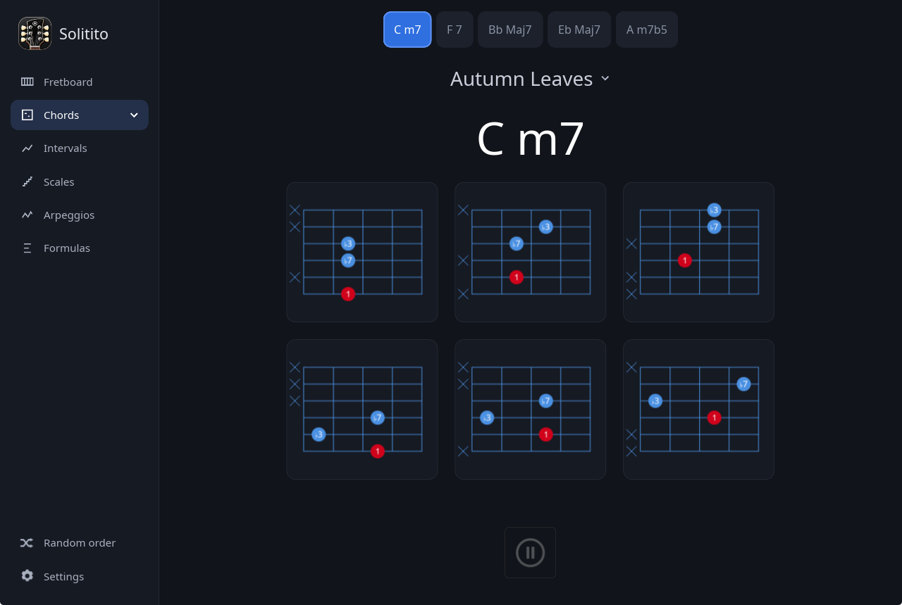
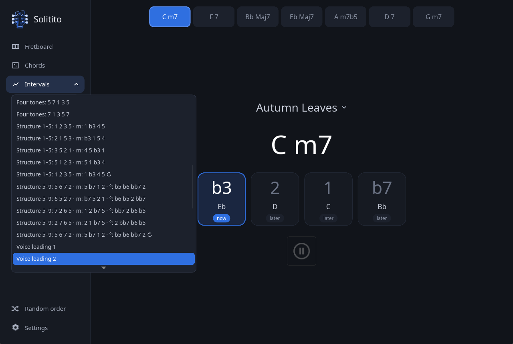
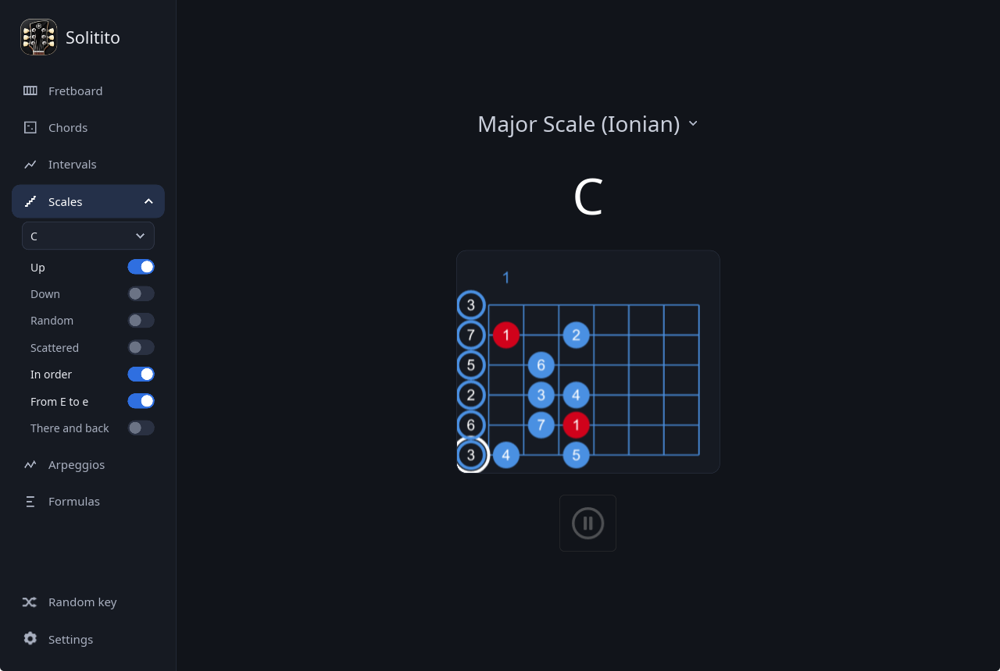
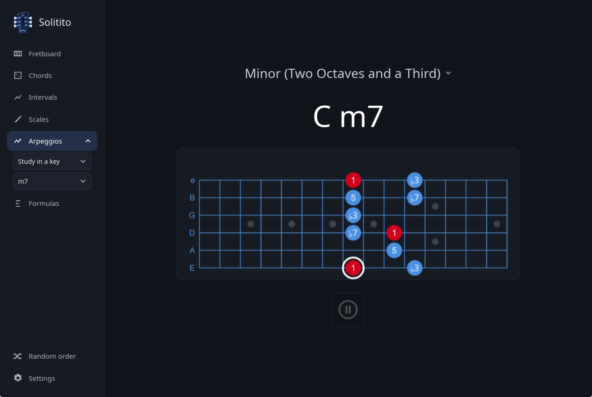
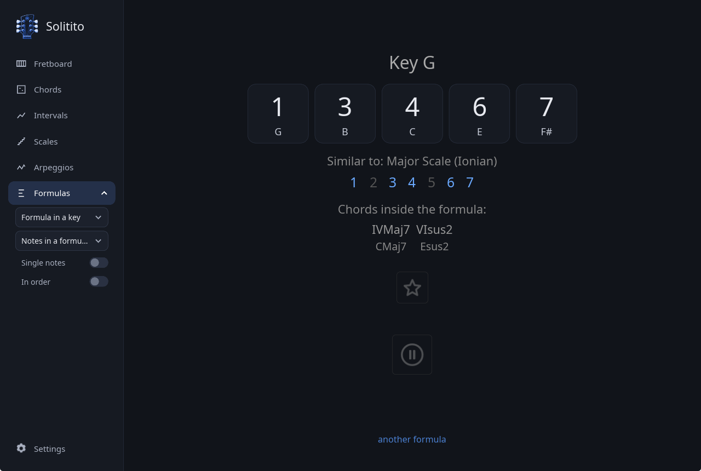

<!-- # Solitito — Real-Time Polyphonic Guitar Trainer -->

*[Wersja polska](README_pl.md)*

**Solitito** is a real-time guitar trainer written in **Rust**. It listens to your guitar
through an audio interface (recommended) or a microphone, recognises what you are playing,
and walks you through jazz standards, intervals, scales, arpeggios and interval formulas.

Recognition runs on a small neural network (7.3M parameters) exported to ONNX. Everything —
DSP, inference, UI — happens locally on the CPU. 

Chord shapes are labelled with **intervals, not fingerings**, so one diagram covers
all twelve keys: the red dot is the root, and the shape moves. Clicking a shape enlarges
it. The shot shows the full grips above and the **shell voicings** below — third and seventh
over the root, with the fifth left out. The strip along the top holds seven chords of the
tune; a click on one pauses and goes there. The quick options of the mode on screen unfold
under it in the side bar — in Chords, the key of the song: pick another and every chord of
the standard is transposed. Below, Intervals with its list of exercises open.

Solitito is heavily inspired by [Solo](https://www.solotrainer.app/), an Android/iOS guitar
trainer which I still use. Solo is great — but it hears one note at a time — when playing
intervals through changes, you have to mute the strings for each note to register.
I kept wondering how Yousician managed to recognise notes of chords polyphonically and
that's how the idea of Solitito was born.

Solitito is a desktop application for Linux and Windows. There are no plans for mobile versions.

Development started in December 2025. The data pipeline was rewritten from scratch more than
once before it worked. Most of what follows is a record of what turned out to matter.

---

## What it does

Pick a song, and the app shows one chord at a time. Play it. When the model hears the right
chord, the app moves on to the next one.

- **Fretboard** — a region of the neck is selected at random (a set of strings, four frets) and
  held; you are asked for notes that live inside it. For learning where the notes are in one
  hand position.
- **Chords** — full jazz standards. Green confirms an exact match, yellow accepts a triad or
  a common substitution (a rootless voicing, an `m7` read as `m`), red means the chord was
  detected but the signal is too weak to lock.
- **Intervals** — play the tones of each chord one at a time, from a list of 50 exercises
  written as degrees, so one exercise fits every chord in a standard: `3` is the major third
  over a major chord and the minor one over a minor chord, `9` and `6` come from the chord's
  own scale. The list goes from single chord tones, pairs and triads, through four-note
  structures from the root and from the fifth, to lines that lead from one chord into the
  next (the seventh falling to the next third), suspensions resolving, and the chord's scale
  through an octave — from any of its tones, with or without the passing note that puts
  every chord tone on a beat. A tone above the octave is written as its compound number — 8,
  9, 10 and on. The list names each exercise by its tones over a major or dominant chord;
  where a minor or half-diminished chord takes other tones they follow `m:`, and a diminished
  chord's follow `°:`. *Structure 1–5: 1 2 3 5 · m: 1 3 4 5* is 1 2 3 5 over a major chord and
  1 ♭3 4 5 over a minor one, where a second would rub against the minor third. ↻ starts each
  chord on a tone drawn for it, the rest following round. With the shuffle on, **Voice leading** in the settings starts each chord on
  its tone nearest the last note played. Strict by default — one note at a time, in order, and only
  what was struck — or turn those three off and strum the grips instead, with the model
  deciding and nothing arguing with it. Every exercise, with examples over each kind of chord,
  is in [practising intervals](docs/intervals-practice.md).
- **Scales** — 47 scales: the modes of the major, melodic minor, harmonic minor and harmonic
  major scales, pentatonics, blues, symmetric and bebop scales. Up, down, or a direction
  drawn for every pass; in order or in any order; **From E to e** — the scale under one hand,
  from the low E string to the high e, the hand standing at a place on the neck drawn for every
  pass: up from the chosen degree on the low E, or down from it on the high e; there and back; started on the 1, 3, 5, 7 or anywhere. The key stays, or
  moves a semitone or round the cycle of fifths or fourths after every pass, or is drawn at
  random, the starting string with it.

- **Arpeggios** — chord tones in sequence over a progression, written as degrees so one
  pattern fits every chord in a standard. Two-octave jazz phrases, plus a generator that
  builds a fresh one after every pass.

- **Formulas** — random selection from all subsets of the 12 chromatic functions that contain "1",
  that is 2¹¹ = 2048. A set of intervals drawn over a root, played in any order. Each function
  lights up when played, and the set is finished when all of them have been played; underneath,
  the nearest scale, with the formula's own degrees picked out of it, and the chords that fit
  inside it — point at one and the row above shows what it is built from. Pause turns the set
  blue and stops judging altogether: your turn, improvise inside it. The same formula can also
  be played over a chord, or carried across a whole standard — see
  [practising with formulas](docs/formulas-practice.md) for how to work with all three.

  A formula worth coming back to is kept with the **star** under it: it asks for a name, and
  the name goes on the list in Practice settings, where picking one draws that formula again
  over whatever key is on screen — a formula is key-independent, so only the set is stored.
  The cross on a row throws it out, and the star, filled in, drops the one on screen.

The Formulas mode is inspired by **An Improviser's OS** by Wayne Krantz — possibly the most
interesting approach to creative improvisation ever put together.

The book is available from [Wayne Krantz](https://waynekrantz.bandcamp.com/merch/wayne-krantz-an-improvisers-os-2nd-edition) directly.

### The chord, scales and arpeggio visual shapes are for the beginning

Every note mode can be shown three ways: a line of degree names, tablature, or the neck
itself — and, if you want, with fret numbers in the dots instead of degrees. The shapes
help while the intervals are still new: they say where the fingers go, and the fret numbers
help further still, for when a shape has to be found on the neck before its degrees mean
anything.

The idea is to stop using them. What this app is for is hearing intervals, not memorising
shapes: reading `1 ♭3 5 ♭7` off a diagram is playing a box, hearing it is playing music. As
the degrees become familiar, switch back to the line of names, and later practise without
the pictures at all.

---

## Read on

The rest of the documentation is in `docs/`:
| | |
|---|---|
| [**Practising intervals**](docs/intervals-practice.md) | The fifty exercises group by group, with what each one asks over every kind of chord, how to read the list, and a II–V–I to try them on |
| [**Practising with formulas**](docs/formulas-practice.md) | Step by step through the three formula exercises: what to play, what to listen for, and what each row on the screen is telling you |
| [Choosing an input](docs/audio-input.md) | What the device names mean on Linux, where settings are stored, the diagnostic modes, and recording a session with what the app made of it |
| [Settings](docs/settings.md) | Every option in the three tabs, and the shuffle, the pause and the chord strip on the main window |
| [How it works](docs/how-it-works.md) | Signal path, the model, and why single notes are not judged by the model alone |
| [Training data and results](docs/training-data.md) | The synthetic set, GuitarSet, and what each fix was worth |
| [Training the models](docs/training.md) | The two trainers: running them, what they write, training the released models again |
| [Custom file formats](docs/file-formats.md) | Your own songs and scales |
| [Running it](docs/running.md) | Packages, and building from source |

## Detailed Project summary

`docs/` holds a long-form write-up of the whole system: architecture, the four
GuitarSet defects and what fixing each one was worth, the training procedure,
the measurements behind every design decision, and the hypotheses that
measurement refuted. Same document in two languages, Markdown and PDF.

| file | |
|---|---|
| [`docs/Solitito_project_summary_en.md`](docs/Solitito_project_summary_en.md) | [PDF](docs/Solitito_project_summary_en.pdf) |
| [`docs/Solitito_project_summary_pl.md`](docs/Solitito_project_summary_pl.md) | [PDF](docs/Solitito_project_summary_pl.pdf) |

## Repository and dataset

- Model and DSP weights: <https://huggingface.co/greblus/solitito-ai>
- Dataset v2 (renders and annotations): <https://huggingface.co/datasets/greblus/solitito_dataset_v2>

Those two hold binary artifacts only. All code lives here.

The `dist/` directory contains everything used to build the dataset and train the model:

| file | role |
|---|---|
| `dataset_generator_v2.py` | generates the GP5 **and** the annotations; self-tests all shapes |
| `verify_annotations.py` | checks that labels describe the audio (numpy only, no librosa) |
| `model_trainer.py` | training of the chord model, `best_model_v2_take6_chords.onnx`; runs on Kaggle, checkpoints to Hugging Face |
| `strike_trainer.py` | training of the strike detector, `short_onset_masking_v2.onnx`; one file, runs on Kaggle |
| `test_strike_trainer.py` | the strike trainer's tests; the feature fixture in `fixtures/` is shared with `src/strike.rs` |
| `extract_onset_branch.py` | cuts the strike branch out of a combined take7 model (`best_model_v2_take7*.onnx`) |
| `gen_weights.py` | sparse pseudo-CQT weights for the Rust side |
| `probe_root.py` | how often the labelled root is actually audible |
| `probe_quality.py` | where chord quality should come from: the head or the pitch vector |
| `probe_sources.py` | which GuitarSet chord annotation to use |
| `inspect_jams.py` | what is actually inside the JAMS files |
| `latency_material.py` | plucks with onsets known by construction, as a yardstick |
| `latency_ground_truth.py` | onsets and pitches of a real recording, for the same measurement |
| `latency_stats.py` | how late the app learns what was played, and how often it learns it wrong |
| `latency_rules.py` | what each crediting rule would cost: credits nobody played, notes missed |
| `gp5_to_arpeggio.py` | turns a Guitar Pro file into the degree notation Arpeggios reads |
| `hf_cleanup.py` | clears the checkpoint repository before a run started from scratch |

---

[1] This project uses the GuitarSet dataset by Qingyang Xi, Rachel M. Bittner, Johan Pauwels,
Xuzhou Ye & Juan P. Bello, available at <https://guitarset.weebly.com/>, licensed under
Creative Commons Attribution 4.0 International (CC BY 4.0).
