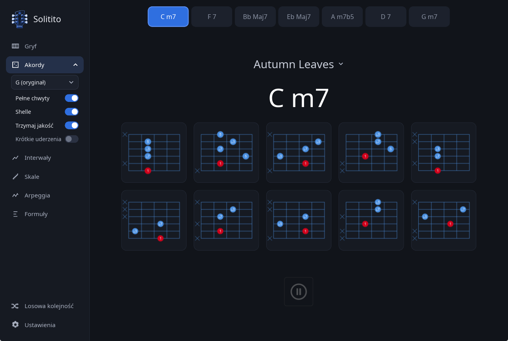
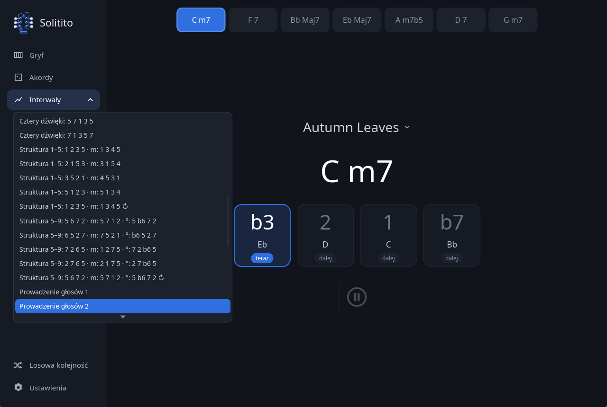
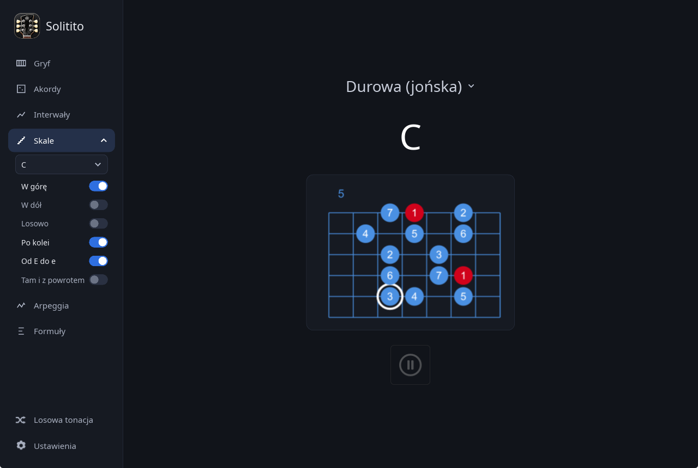
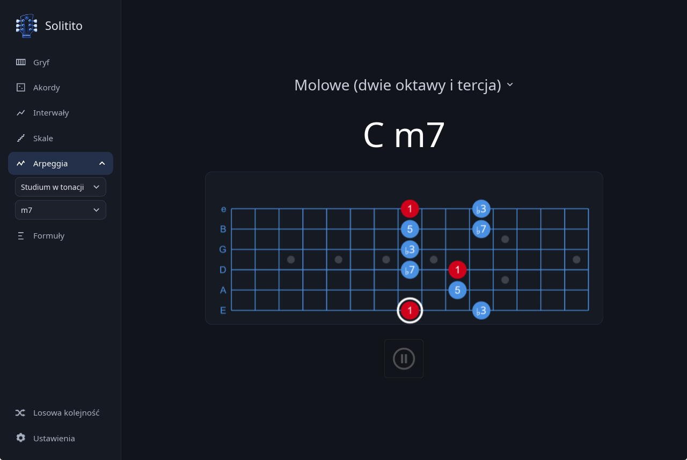
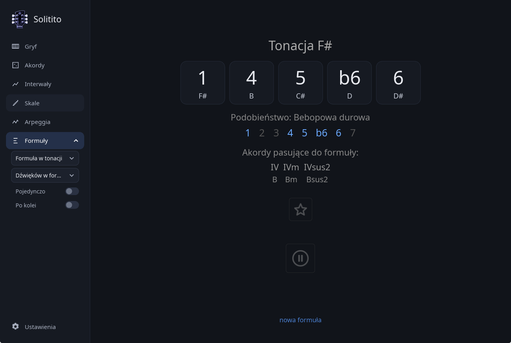

<!-- # Solitito — trener gitary czasu rzeczywistego -->

*[English version](README.md)*

**Solitito** to trener gitarowy czasu rzeczywistego napisany w **Rust**. Słucha gitary przez
interfejs audio (zalecany) albo mikrofon, rozpoznaje, co grasz, i prowadzi przez standardy
jazzowe, interwały, skale, arpeggia i formuły interwałowe.

Rozpoznawanie działa na niewielkiej sieci neuronowej (7,3 mln parametrów) wyeksportowanej do
ONNX. Wszystko — DSP, wnioskowanie, interfejs — dzieje się lokalnie.

Schematy akordów opisane są **interwałami**, więc jeden diagram obsługuje
wszystkie dwanaście tonacji: czerwona kropka to pryma, kliknięcie w
schemat powiększa go. Zrzut pokazuje u góry pełne chwyty, a pod nimi **shell voicingi** —
tercja i septyma nad prymą, bez kwinty. Pasek u góry trzyma siedem akordów utworu;
kliknięcie w jeden zatrzymuje ćwiczenie i przechodzi do niego. Szybkie opcje bieżącego trybu
rozwijają się pod nim w pasku bocznym — w Akordach tonacja utworu: wybór innej transponuje
każdy akord standardu. Niżej Interwały z rozwiniętą listą ćwiczeń.

Solitito jest mocno zainspirowane [Solo](https://www.solotrainer.app/), trenerem na
Androida i iOS, z którego nadal korzystam. Solo jest super — ale słyszy jeden dźwięk naraz —
grając interwały przez zmiany harmoniczne, trzeba tłumić struny, żeby każdy dźwięk został
rozpoznany, a to mało muzyczny sposób ćwiczenia i psuje cały fun. Zastanawiałem się od dawna,
jak Yousician rozpoznaje akordy polifonicznie i tak powstało Solitito.

Program jest aplikacją desktopową dla Linuksa i Windowsa. Wersji mobilnych nie planuję.

Prace ruszyły w grudniu 2025. Procedura szkolenia modelu i sam program w Rust był przepisywany od zera
więcej niż raz, zanim zadziałał. To, co opisano poniżej, jest w większości zapisem tego, co okazało się
mieć znaczenie.

---

## Co to robi?

Wybierasz utwór, a program pokazuje jeden akord. Po zagraniu go, gdy model usłyszy właściwy
akord, przechodzi do następnego.

- **Gryf** — losowany jest fragment gryfu (zestaw strun, cztery progi) i program
  prosi o kolejne dźwięki, które znajdują się w tym, ograniczonym pozycją ręki, fragmencie gryfu. 
- **Akordy** — pełne standardy jazzowe. Zielony potwierdza trafienie dokładne, żółty przyjmuje
  triadę albo substytucję (voicing bez prymy, `m7` odczytane jako `m`), czerwony znaczy, że
  akord został wykryty, ale sygnał jest za słaby, by go zatwierdzić.
- **Interwały** — dźwięki każdego akordu grane pojedynczo, z listy 50 ćwiczeń zapisanych
  stopniami, więc jedno ćwiczenie pasuje do każdego akordu w standardzie: `3` to tercja wielka
  nad akordem durowym i mała nad molowym, `9` i `6` pochodzą ze skali akordu. Lista idzie od
  pojedynczych składników, par i triad, przez czterodźwiękowe struktury od prymy i od kwinty,
  do linii prowadzących z akordu w następny (septyma schodzi na tercję kolejnego), rozwiązań
  zawieszeń i skali akordu przez oktawę — od dowolnego jej dźwięku, z dźwiękiem przejściowym,
  który stawia każdy składnik akordu na mocnej części taktu, albo bez niego. Dźwięk powyżej
  oktawy ma swój numer złożony — 8, 9, 10 i dalej. Lista podpisuje każde ćwiczenie dźwiękami
  nad akordem durowym i dominantowym; gdzie akord molowy lub półzmniejszony bierze inne, stoją
  po `m:`, a dźwięki akordu zmniejszonego po `°:`. *Struktura 1–5: 1 2 3 5 · m: 1 3 4 5* to
  1 2 3 5 nad akordem durowym i 1 ♭3 4 5 nad molowym, bo sekunda leży o półton od małej tercji
  i brzmi z nią dysonansowo. ↻ oznacza losowy przewrót. Przy losowaniu **Prowadzenie głosów**
  w ustawieniach zaczyna każdy akord od składnika najbliższego ostatnio zagranemu dźwiękowi.
  Domyślnie surowo — pojedynczo, po kolei i tylko to, co uderzone — albo wyłącz te trzy
  i graj chwyty, a decyduje sam model. Każde ćwiczenie z przykładami nad każdym rodzajem akordu
  opisuje [ćwiczenie interwałów](docs/intervals-practice_pl.md).
- **Skale** — 47 skal: mody skali durowej, molowej melodycznej, molowej harmonicznej
  i durowej harmonicznej, pentatoniki, bluesowe, symetryczne i bebopowe. W górę, w dół albo
  kierunek losowany na każdy przebieg; po kolei albo w dowolnej kolejności; **Od E do e** —
  skala pod jedną ręką, od niskiej struny E do wysokiej e, a ręka stoi w miejscu gryfu
  losowanym na każdy przebieg: w górę od wybranego stopnia na niskiej E albo w dół od niego
  na wysokiej e; tam i z powrotem; początek na 1, 3, 5, 7 albo
  gdziekolwiek. Tonacja zostaje albo po każdym przebiegu przesuwa się o półton, kołem
  kwintowym lub kwartowym, albo jest losowana — razem ze struną, od której zaczyna się skala.

- **Arpeggia** — składniki akordu w kolejności lub losowo, przez progresję, zapisane stopniami, więc
  jeden wzorzec pasuje do każdego akordu w standardzie. Dwuoktawowe frazy jazzowe oraz
  generator budujący nowe arpeggio po każdym przejściu.

- **Formuły** — losowo wybrana spośród wszystkich podzbiorów dwunastu funkcji chromatycznych
  zawierających prymę, czyli 1 z 2¹¹ = 2048 formuł. Zbiór interwałów gramy  w dowolnej kolejności.
  Każda funkcja zapala się na zielono, gdy zabrzmi, a zbiór jest zaliczony, kiedy zazielenią się
  wszystkie; pod spodem najbliższa skala z wyróżnionymi stopniami formuły oraz akordy w niej zawarte —
  wskaż jeden, a linia powyżej pokaże, z czego jest zbudowany. Pauza zmienia zbiór na
  niebieski i wstrzymuje ocenianie: twoja kolej, improwizuj. Tę samą formułę można też zagrać
  na akordzie albo ograć nią cały standard — jak pracować ze wszystkimi trzema, opisuje
  [ćwiczenie z formułami](docs/formulas-practice_pl.md).

  Formułę można dodać do Ulubionych klikając na **gwiazdkę** pod nią: program pyta o nazwę i trafia
  ona na listę w ustawieniach Ćwiczeń, skąd wybór przywraca tę formułę dla dowolnej tonacji, która
  akurat jest na ekranie — formuła jest niezależna od tonacji, więc zapisywany jest sam zbiór interwałów.
  Krzyżyk w wierszu Ulubionych usuwa wpis, a kliknięcie w oknie głównym zaświeconej gwiazdki, porzuca
  formułę widoczną na ekranie.

Tryb Formuł jest zainspirowany książką **An Improviser's OS** Wayne'a Krantza — być może
najciekawszym podejściem do kreatywnej improwizacji, jakie powstało.

Książkę można kupić bezpośrednio u [Wayne'a Krantza](https://waynekrantz.bandcamp.com/merch/wayne-krantz-an-improvisers-os-2nd-edition).
Warto też posłuchać jego muzyki, bo to genialny muzyk i improwizator.

### Wyświetlanie kształtów na podstrunnicy i tabulatur to pomoc na początku

Każdy tryb nutowy można pokazać na trzy sposoby: linii interwałów, tabulatury albo schematu
na podstrunnicy — a jeśli trzeba, z numerami progów zamiast stopni. Obrazki pomagają,
dopóki interwały są czarną magią i wydają się trudne, z czasem stanie się to naturalne.

Ważne, żeby z nich w końcu zrezygnować. Ten program ma nauczyć wizualizacji w głowie i połączenia
ucha z rękami, zamiast klepania schematów.

---

## Czytaj dalej

Reszta dokumentacji w `docs/`:
| | |
|---|---|
| [**Ćwiczenie interwałów**](docs/intervals-practice_pl.md) | Pięćdziesiąt ćwiczeń grupa po grupie: co każde każe zagrać nad każdym rodzajem akordu, jak czytać listę i II–V–I do wypróbowania |
| [**Ćwiczenie z formułami**](docs/formulas-practice_pl.md) | Trzy ćwiczenia z formułami krok po kroku: co grać, czego słuchać, co to za szyfry na ekranie |
| [Wybór wejścia](docs/audio-input_pl.md) | Co znaczą nazwy urządzeń w Linuksie, gdzie trzymane są ustawienia i jakie są tryby diagnostyczne |
| [Ustawienia](docs/settings_pl.md) | Wszystkie opcje z trzech zakładek oraz losowanie, pauza i pasek akordów w oknie głównym |
| [Jak to działa](docs/how-it-works_pl.md) | Ścieżka sygnału, model i powód, dla którego pojedynczych dźwięków nie sądzi sam model |
| [Dane treningowe i wyniki](docs/training-data_pl.md) | Zbiór syntetyczny, GuitarSet i wartość każdej poprawki |
| [Trening modeli](docs/training_pl.md) | Dwa trenery: uruchamianie, co zapisują, ponowne wytrenowanie wydanych modeli |
| [Własne formaty plików](docs/file-formats_pl.md) | Własne utwory i skale |
| [Uruchamianie](docs/running_pl.md) | Paczki i budowanie ze źródeł |

## Szczegółowe podsumowanie projektu

W `docs/` leży obszerne opracowanie całego systemu: architektura, cztery wady GuitarSetu i
wartość naprawienia każdej z nich, procedura treningu, pomiary stojące za każdą decyzją
projektową oraz hipotezy, które pomiar obalił. Ten sam dokument w dwóch językach, w Markdownie
i w PDF.

| plik | |
|---|---|
| [`docs/Solitito_project_summary_pl.md`](docs/Solitito_project_summary_pl.md) | [PDF](docs/Solitito_project_summary_pl.pdf) |
| [`docs/Solitito_project_summary_en.md`](docs/Solitito_project_summary_en.md) | [PDF](docs/Solitito_project_summary_en.pdf) |

## Repozytorium i zbiór danych

- Model i wagi DSP: <https://huggingface.co/greblus/solitito-ai>
- Zbiór danych v2 (rendery i adnotacje): <https://huggingface.co/datasets/greblus/solitito_dataset_v2>

Oba miejsca zawierają wyłącznie artefakty binarne. Cały kod jest tutaj.

Katalog `dist/` zawiera wszystko, czym zbudowano zbiór danych i wytrenowano model:

| plik | rola |
|---|---|
| `dataset_generator_v2.py` | generuje plik GP5 **i** adnotacje; sam sprawdza wszystkie akordy |
| `verify_annotations.py` | kontroluje, czy etykiety opisują dźwięk (samo numpy, bez librosy) |
| `model_trainer.py` | trening modelu akordów, `best_model_v2_take6_chords.onnx`; działa na Kaggle, punkty kontrolne na Hugging Face |
| `strike_trainer.py` | trening detektora uderzeń, `short_onset_masking_v2.onnx`; jeden plik, działa na Kaggle |
| `test_strike_trainer.py` | testy trenera uderzeń; plik cech w `fixtures/` jest wspólny z `src/strike.rs` |
| `extract_onset_branch.py` | wycina gałąź uderzeń z połączonego modelu take7 (`best_model_v2_take7*.onnx`) |
| `gen_weights.py` | rzadkie wagi pseudo-CQT dla strony rustowej |
| `probe_root.py` | jak często oznaczona pryma jest faktycznie słyszalna |
| `probe_quality.py` | skąd powinna pochodzić jakość akordu: z głowicy czy z wektora wysokości |
| `probe_sources.py` | której adnotacji akordowej z GuitarSetu użyć |
| `inspect_jams.py` | co naprawdę znajduje się w plikach JAMS |
| `latency_material.py` | szarpnięcia o atakach znanych z konstrukcji, jako wzorzec |
| `latency_ground_truth.py` | ataki i wysokości prawdziwego nagrania, do tego samego pomiaru |
| `latency_stats.py` | jak późno aplikacja dowiaduje się, co zagrano, i jak często źle |
| `latency_rules.py` | ile kosztuje każda reguła zaliczania: zaliczenia niegrane, dźwięki pominięte |
| `gp5_to_arpeggio.py` | przekłada plik Guitar Pro na zapis stopniami, który czyta tryb Arpeggia |
| `hf_cleanup.py` | czyści repozytorium punktów kontrolnych przed przebiegiem od zera |

---

[1] Projekt korzysta ze zbioru GuitarSet autorstwa Qingyang Xi, Rachel M. Bittner, Johana
Pauwelsa, Xuzhou Ye i Juana P. Bello, dostępnego pod adresem <https://guitarset.weebly.com/>,
na licencji Creative Commons Attribution 4.0 International (CC BY 4.0).
