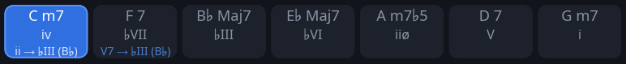

# Analysing and learning progressions

The chord strip at the top of the window (Chords, Intervals and Arpeggios over the changes) shows not only which chord is
now but also where it stands in the tune and where it leads. Turn it on with **Degrees in the chord strip** in the
[settings](settings.md). Once you know the progression, turn the strip off and keep the next chords in your head — see
[playing without the chord strip](intervals-practice.md#playing-without-the-chord-strip).

## Degrees and functions in the chord strip

Each chip has three lines: the chord, its **degree** in the tune and — smaller — **where it leads**. Autumn Leaves
in G minor:

| Chord | Degree | Leads | What it means |
|---|---|---|---|
| Cm7 | `iv` | `ii → B♭` | minor on the fourth degree; here the ii of a ii–V–I to B♭ |
| F7 | `♭VII` | `V7 → B♭` | the flat seventh degree (F, not F♯); the dominant of B♭ |
| B♭maj7 | `♭III` | | the target: the relative major |
| E♭maj7 | `♭VI` | | on round the cycle of fifths |
| Am7♭5 | `iiø` | | the half-diminished ii of a minor ii–V–i |
| D7 | `V` | | the key's dominant: it goes home, which the degree already says |
| Gm7 | `i` | | home |

First a ii–V–I to the relative major, then a minor iiø–V–i home.

The **degree** is counted from the tune's home on the major scale, with its accidental: in G minor an `F7` is
`♭VII` and an `F♯°` `vii°`. Upper case over a major third, lower over a minor one. `ø` is half-diminished (m7♭5: a
diminished fifth, a minor seventh), `°` diminished (dim7: fifth and seventh diminished). A diminished chord between
two degrees is counted from the lower: `F♯°` in F is `♯i°`. Degrees are counted from home, so a transposed tune
keeps them.

**Leads** is shown only when the chord goes somewhere other than home, and names the target chord:

- `V7 → x` — a dominant whose next different chord lies a fifth below. Repeated (`C7 C7 F`), it leads from both bars.
- `subV7 → x` — a dominant resolving a semitone down, the tritone substitute; shown going home too, as `♭II`
  alone does not say it.
- `ii → x`, `iiø → x` — the minor or half-diminished chord before such a dominant.
- An unresolved ii–V (`Em7 A7 Em7 A7` in Satin Doll) names the target it implies.
- In a chain of dominants each leads to the nearest: `A7 D7 G7 C` is `V7 → D`, `V7 → G`, `V`, `I`.

Left without a lead: the dominant on the home of a blues (`I7`), the backdoor (`Fm7 B♭7 → C` is `iv ♭VII I`), and a
dominant that resolves nowhere. The strip plays round, so the last chord leads to the first.
