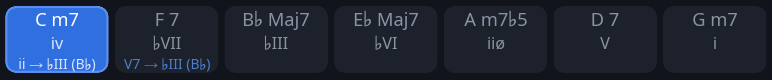

# Analiza i nauka progresji

Pasek akordów na górze okna (Akordy, Interwały i Arpeggia po zmianach) pokazuje nie tylko, który akord jest teraz, ale też
jego miejsce w utworze i to, dokąd prowadzi. Włącza się to opcją **Stopnie na pasku akordów** w [ustawieniach](settings_pl.md).
Gdy progresję już znasz, wyłącz pasek i miej kolejne akordy w głowie — zobacz
[grę bez paska akordów](intervals-practice_pl.md#gra-bez-paska-akordów).

## Stopnie i funkcje na pasku akordów



Każdy akord na pasku zapisany jest w trzech wierszach: nazwa, jego **stopień** w utworze i — drobniej — **dokąd prowadzi**. Na przykładzie
Autumn Leaves w g-moll:

| Akord | Stopień | Dokąd | Co to znaczy |
|---|---|---|---|
| Cm7 | `iv` | `ii → ♭III (B♭)` | w g-moll `iv`, akord molowy na czwartym stopniu, a zarazem `ii` w B♭-dur, do którego prowadzi |
| F7 | `♭VII` | `V7 → ♭III (B♭)` | w g-moll `♭VII`, na obniżonym siódmym stopniu (F, nie F♯), a zarazem `V` w B♭-dur: dominanta B♭ |
| B♭maj7 | `♭III` | | cel: relatywna dur |
| E♭maj7 | `♭VI` | | dalej po kole kwintowym |
| Am7♭5 | `iiø` | | półzmniejszony ii molowego ii–V–i |
| D7 | `V` | | dominanta tonacji: idzie do toniki, co mówi już stopień |
| Gm7 | `i` | | tonika |

### Cała progresja: dwie kadencje

Autumn Leaves to nie jedno ii–V–i, tylko dwie kadencje na zmianę:

```
Cm7   F7    B♭maj7  E♭maj7 │ Am7♭5  D7   Gm7
ii    V     I       (IV)   │ iiø    V    i
└── ii–V–I w B♭-dur ──┘      └── ii–V–i w g-moll ──┘
```

1. **ii–V–I w B♭-dur**, relatywnej dur: Cm7 F7 B♭maj7. Durowe ii–V–I ma ii molowe (m7) i tonikę maj7.
2. **ii–V–i w g-moll**: Am7♭5 D7 Gm7. Molowe ma ii półzmniejszone (m7♭5) i tonikę molową.

Między nimi E♭maj7 — w B♭-dur IV, w g-moll ♭VI — przeprowadza z jednej tonacji do drugiej. Całość idzie po kole
kwintowym, każdy akord kwartę wyżej od poprzedniego: C → F → B♭ → E♭ → A → D → G. W jednym chorusie są więc obie
odmiany ii–V, durowa i molowa, w tonacjach relatywnych, czyli na tych samych dźwiękach. Części utworu układają te
dwie kadencje w różnej kolejności: pierwsze zaczynają od durowej i kończą molową, środkowa (Am7♭5 D7 Gm7, potem
Cm7 F7 B♭maj7 E♭maj7) odwrotnie.

Na pasku widać to po dopiskach: pierwsza kadencja ma `→ ♭III (B♭)`, druga nie ma żadnych, bo prowadzi do toniki,
co mówi już stopień.

### Jeden akord, dwa punkty odniesienia

Stopień i dopisek liczą od dwóch różnych dźwięków. **Stopień** liczy od toniki utworu, **dopisek** — od akordu,
do którego ten akord właśnie prowadzi. Weźmy Cm7:

| Liczone od | Kolejne stopnie | C to | Cm7 to |
|---|---|---|---|
| G — tonika utworu, g-moll | G A B♭ **C** D E♭ F | 4. stopień | `iv` |
| B♭ — cel, B♭-dur | B♭ **C** D E♭ F G A | 2. stopień | `ii` |

Oba zapisy są prawdziwe naraz, bo g-moll i B♭-dur to tonacje relatywne: mają te same dźwięki, różnią się tylko tym,
gdzie jest dom. Cm7 F7 B♭maj7 to w g-moll `iv ♭VII ♭III`, a w B♭-dur `ii V I`. Ucho słyszy w tym miejscu krótką
kadencję do B♭, po czym utwór wraca do g-moll przez Am7♭5 i D7. Taki akord, który znaczy jedno w jednej tonacji
i drugie w drugiej, nazywa się akordem wspólnym (ang. *pivot chord*).

Czyli górny wiersz mówi, **gdzie akord stoi w całym utworze**, a dolny — **jaką rolę gra teraz**, w lokalnym
ii–V–I. W praktyce: nad Cm7 F7 B♭maj7 można myśleć „B♭-dur” i grać to, co zna się z ii–V–I, zamiast liczyć
wszystko od G. Dopisek mówi, w którą tonację na chwilę przejść; stopień — gdzie się jest, gdy z niej się wraca.

**Stopień** liczony jest od toniki utworu na skali durowej, ze znakiem: w g-moll `F7` to `♭VII`, a `F♯°` to `vii°`.
Wielka litera nad tercją wielką, mała nad małą. `ø` to akord półzmniejszony (m7♭5: kwinta zmniejszona, septyma
mała), `°` zmniejszony (dim7: kwinta i septyma zmniejszone). Akord zmniejszony między dwoma stopniami liczony jest
od dolnego: `F♯°` w F to `♯i°`. Stopnie liczone są od toniki, więc po transpozycji są takie same.

**Dokąd** stoi tylko wtedy, gdy akord prowadzi gdzie indziej niż do toniki, a cel podany jest stopniem w utworze, z nazwą akordu w nawiasie — `V7 → ♭III (B♭)`:

- `V7 → x` — dominanta, po której następny inny akord leży kwintę niżej. Powtórzona (`C7 C7 F`) prowadzi z obu taktów.
- `subV7 → x` — dominanta rozwiązująca się pół tonu w dół, podstawienie trytonowe; podpisane także przy tonice,
  bo sam stopień `♭II` tego nie mówi.
- `ii → x`, `iiø → x` — akord molowy albo półzmniejszony przed taką dominantą.
- ii–V bez rozwiązania (`Em7 A7 Em7 A7` w Satin Doll) podaje cel, który zapowiada.
- W łańcuchu dominant każda prowadzi do najbliższej: `A7 D7 G7 C` to `V7 → II (D)`, `V7 → V (G)`, `V`, `I`.

Bez dopisku zostają: dominanta na tonice bluesa (`I7`), backdoor (`Fm7 B♭7 → C` to `iv ♭VII I`) i dominanta, która
nigdzie się nie rozwiązuje. Pasek gra w kółko, więc ostatni akord prowadzi do pierwszego.
