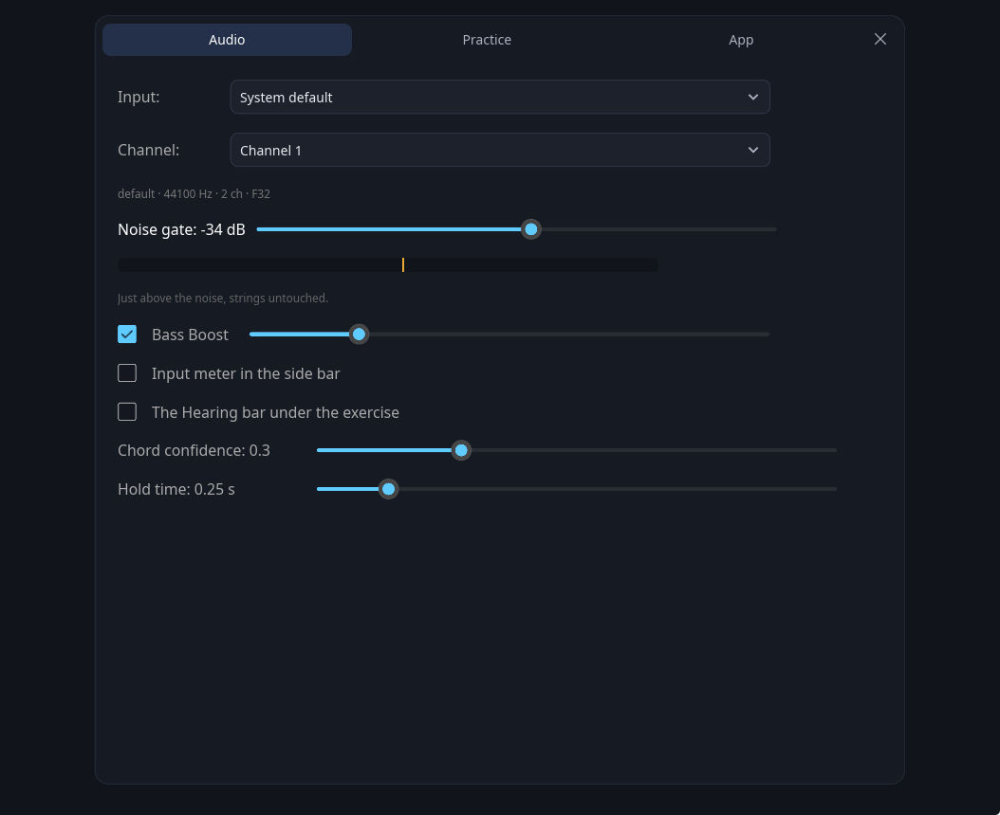
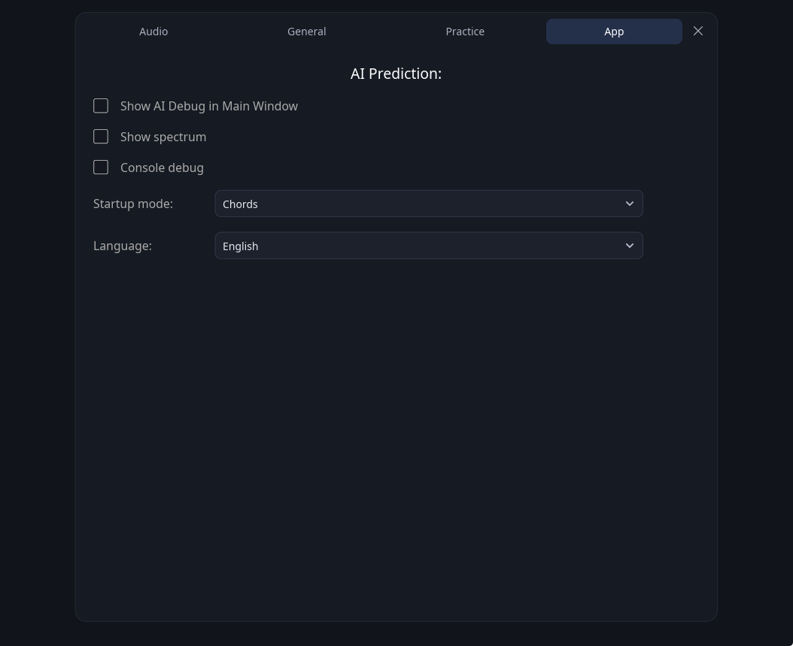
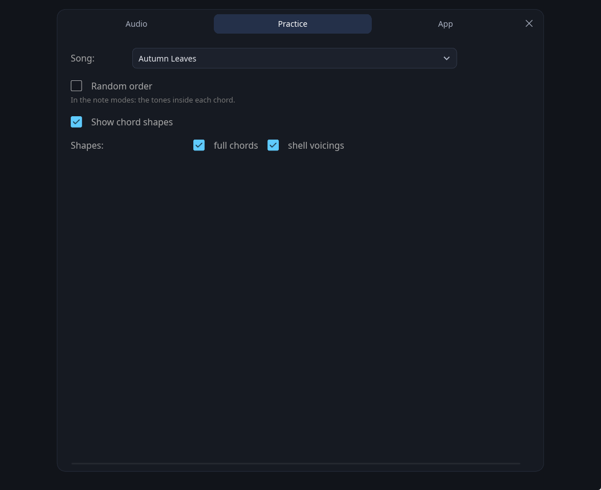
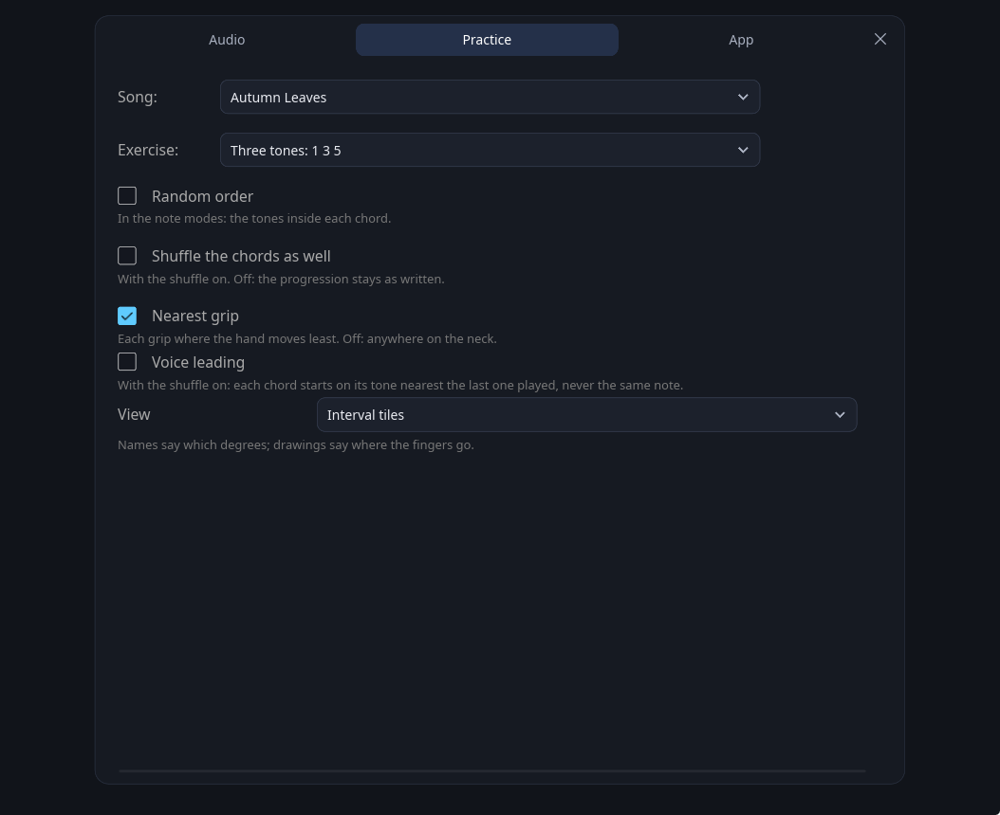
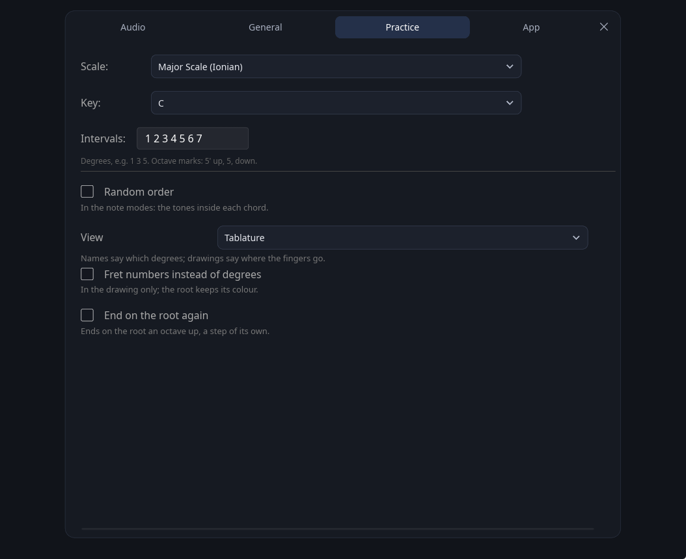
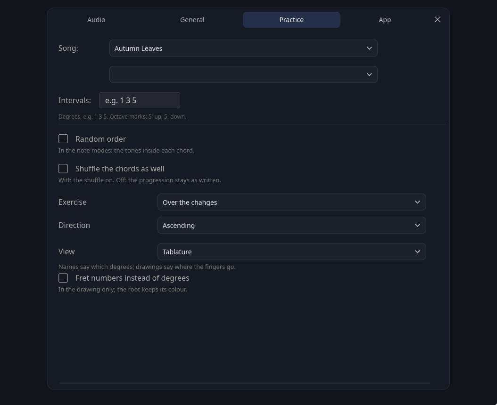
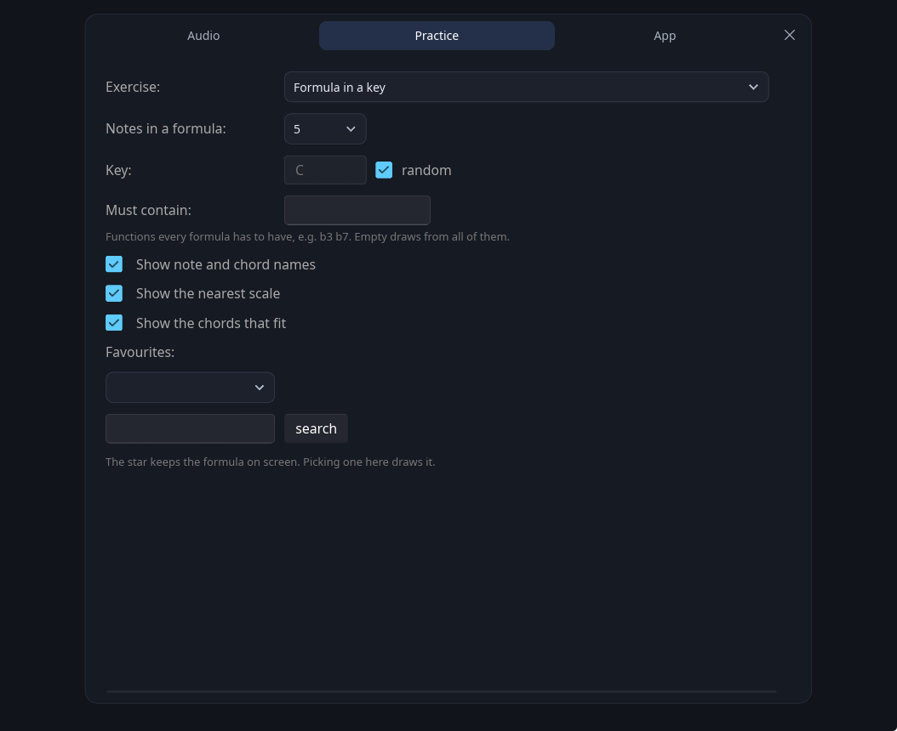

# Settings

Every option in the three tabs, and the controls on the main window.

[← back to the README](../README.md)

---

Three tabs: **Audio** for the input, the noise gate and the model's thresholds, **Practice**
for what to play, and **App** for what the window shows. How strictly what you play is judged
is set in the quick options of each mode, in the side bar — see [the main window](#the-main-window).

**Practice** holds only what belongs to the mode on screen — a song has nothing to say in
Formulas, a formula nothing in Chords — so it is a different tab in each of them, and the
fretboard trainer, which has no settings of its own, does not show it at all:

| Setting | Description |
|---|---|
| **Song / Scale** | Chooses the progression or scale for the current mode. The standard you pick is remembered — between sessions too — and follows you through every mode that reads it: Chords, Intervals, Arpeggios over the changes and Formulas over a standard. The scale the same way: Scales comes back to the one you left off on, not to the top of the list |
| **Study** | Arpeggios, in the study exercise: which phrase to walk. The shuffle switch means the KEY here: a new one after every pass. An arpeggio is a phrase, so there is nothing in it to shuffle, and the study itself is left as chosen — the generator is a row in the list for anyone who wants a fresh phrase as well. The three chord-quality studies come first, then the broken thirds and triplets, then plain two-octave runs, and last a generator that builds a fresh phrase after every pass. The second combo beside it holds the key |
| **Exercise** (arpeggios) | *Study in a key* stands on one chord — its quality is set below, its key beside the study, and the shuffle draws a new key after every pass. *Over the changes* takes the chords from a tune and builds one arpeggio per chord |
| **Direction** | Over the changes: ascending, descending, or alternating from either side. Descending is the shape the studies use — from the root **downwards** through the chord's own tones, not the ascending phrase read backwards |
| **View** | Three ways to show the exercise: the line of degree names, tablature, or the neck itself. Kept per mode and remembered — a scale is an order of notes and reads as tablature, a grip is a hand shape and says nothing until it is on the neck. Tablature by default in Scales and Arpeggios, the neck in Intervals and the fretboard trainer. A phrase — a scale or an arpeggio — is drawn on the neck it is played on, with the note due ringed in white and every place already played green. An up-and-down phrase comes back to its own places, so by the turn the shape is green all through and the ring is what says where the player is on the way down — the tablature rings it too, which is what tells you where you are in a scale dealt in a drawn order; the picture is the size of a hand however long the phrase is, so a thirty-note study stays readable. A scale is drawn in a position drawn at random — the shape is the same everywhere, and the point is to know it wherever the hand lands. In the fretboard trainer the picture is the REGION: the strings named down the left, the ones out of play dimmed, the frets in play, and — once the note asked for is played — every place inside the region where it lies, in green. Nothing is drawn before that, and a wrong note is not drawn at all: where the note lies is the exercise. Each dot carries the degree as the exercise writes it, so a scale spelling its altered second `#2` reads `♯2` on the neck too. In Intervals the set is drawn as a GRIP: a chord box like the shape diagrams, strings across and frets down, with the position beside it — a strip has the ORDER of the notes on its horizontal axis, which says nothing about where the fingers go. With **Nearest grip** on — the default — each grip is taken where the fingers have least to move from the one before, so a progression walks itself across the neck. Off, every chord is taken wherever the neck is drawn to offer it, which is how one shape is learned all over the neck instead of in one corner of it; the shuffle switches the leading off as well. With the shuffle on there is no line to lead: the chords come in a drawn order and each grip is taken where the neck offers it. Which string a dot sits on is the octave, so nothing needs an apostrophe; what has been played lights green either way. Intervals has a fourth view, **tiles**: each degree on a card, with the note it falls on this chord and whether it is due, still to come or done |
| **Fret numbers instead of degrees** | In that drawing only. The root keeps its colour |
| **Key** | Scales: the tonic, also in the quick options. With **Random key** on it is drawn at once and again after each pass, and the string the scale starts from with it. In Chords the quick options hold the key of the song: another key transposes every chord of the standard, *(original)* puts it back, and a new song starts in its own |
| **Exercise** (intervals) | Which tones of each chord, and in what order — fifty exercises, written as degrees and read against the chord: `3` and `7` are whatever third and seventh the chord has, `2`, `4`, `6` and `9` come from its scale (Lydian over a major seventh, Mixolydian over a dominant, Dorian over a minor seventh, Locrian with a natural ninth over a half-diminished chord, whole-half over a diminished one, melodic minor over `m6` and `mMaj7`). In order: single chord tones, pairs, triads and four-note chords, also as a random inversion (↻); four-note structures from the root and from the fifth in four orders; voice leading for II-V-I, where each chord's cell ends a step from where the next one starts; a suspension resolving to the third; and the chord's scale through an octave, from the 1, 3, 5, 7 or a drawn tone, with or without the passing note — `(7)` or `(#5)` — that puts every chord tone on a beat. The shuffle deals the sets and the first cell of each structure in another order; the rest are played as written. The degrees are written plain, without the octave - `5 6 7 2`, `1 3 5 7 1`: the judge hears which note and not how high, so each may be played wherever the hand has it |
| **Intervals** | Scales and Arpeggios: the degrees of the run, as text. `3` matches both major and minor thirds, `5` perfect and diminished fifths, according to the chord quality. Above the octave the compound numbers — `9`, `10`, `12` — or an apostrophe, `5'`; below the root a comma, `5,` |
| **Show AI Debug in Main Window** | Shows the raw prediction on the main screen |
| **Input** | Which capture device to open. *System default* follows whatever the OS is set to. Saved, and falls back to the default if that device is gone |
| **Channel** | Which input of that device to listen on — a guitar in socket 2 of an interface is channel 2. Shown only when the device has more than one, and there is no mixing option: averaging the inputs pulls in whatever is on the other socket and costs 6 dB |
| **Noise gate** | Threshold in dBFS. The bar below shows the current input level on the same scale, with the threshold marked by a yellow line — set it just above the noise with the strings untouched |
| **Input meter in the side bar** | The same level and yellow line, in a card in the side bar, with the device and channel above it and whether the guitar is heard. Off by default; a click on the card opens the Audio tab |
| **The Hearing bar under the exercise** | What the model names and the notes it hears, under the exercise. Off by default — while playing it pulls the eye away from the shapes |
| **Bass Boost** | Digital amplification of the lowest CQT bins. Useful for laptop microphones, which usually roll off the low strings |
| **Hold the quality** (quick option, Chords) | Holds the recognised quality until you strike the strings again. Without it, a held `m7` turns into `m` as the seventh dies away |
| **Short strums** (quick option, Chords) | For chords struck and released rather than held. One clear reading of the target counts, and the decay that follows cannot undo it. A wrong chord still fails |
| **Struck only** (quick option, Intervals) | Note modes: the model may credit a note only where the strike detector reported that very note struck in the last 0.35 s — the chord-name reading included, which used to slip through and credit whatever note the model's root happened to be. Measured on a recording of single notes, two thirds of the credits it hands to a note other than the one being played carry no attack at all — almost always the previous note, still ringing inside its 0.77 s window. On by default in Intervals, with a separate saved choice; off by default in other modes. The single-frame estimate is not governed by it; in Formulas it has a rule of its own, see [How it works](how-it-works.md) |
| **Single notes** (quick option) | Offered in Intervals and Formulas. In Scales, Arpeggios and the fretboard trainer the rule is in force whatever the setting says — nobody strums a scale — and Chords has its own. In Formulas, on, a function counts only on the single-frame estimate, one note at a time; off, a strummed set counts every tone it sounds — over 17 chords struck whole, 64 of their 68 tones against 17. Off, a strummed chord passes its intervals one after another — the pitch head is polyphonic and reports every tone at once. On, nothing but the single-frame estimate counts, and only once it has held for three audio frames: measured over 49 notes, the four ways in together credited 110 things nobody played, the steady estimate alone 33, and it missed none. **On by default in Intervals**, with the fixed order and "only what was struck" — the three together are the measured path. Turn all three off and the mode becomes the other thing it can be: the model decides and nothing argues with it, carry-over between chords included, which is Intervals without “one at a time, in order, only what was struck” |
| **Random order** | The shuffle icon on the toolbar. In the note modes it shuffles the tones inside each chord; in Chords it reorders the progression, and in Scales it redraws the key after every pass |
| **Shuffle the chords as well** | Intervals and Arpeggios only, and only with the shuffle on. Off, the progression stays as written and just the tones move — shuffled intervals walking a real progression turn into tunes. On, the chords are drawn at random too, which is the more abstract exercise |
| **Exercise** (formulas) | *Formula in a key* is the mode as it was. *Over a chord* plants the same formula on one drawn chord, and *Over the changes* plants it on every chord of a tune in turn — the formula is the constant, the harmony moves under it |
| **Placement** | Over a chord: which kind to draw — one that spells the chord out, one that colours it, one outside it, or any. The screen shows the formula's functions read from the chord's root, with the chord's own tones in blue, and counts them |
| **Notes in a formula** | Formulas only: how many functions each drawn formula has, the root included |
| **Key** (formulas) | The root to read them against, or a fresh one drawn per formula |
| **Must contain** | Only draw formulas holding these functions, e.g. `b3 b7`. Empty draws from all 2048 |
| **Show note and chord names** | Formulas only: the letters under the functions and under the chords |
| **Show the nearest scale** | Formulas only: the closest scale you already know, spelled out with the formula's own degrees picked out |
| **Show the chords that fit** | Formulas only: chords playable without leaving the set, written as degrees. Only the fullest — over the major scale that leaves exactly the seven diatonic sevenths |
| **Favourites** | Formulas only: the star keeps the formula on screen under a name, and the list draws it again. A cross on a row throws it out |
| **In order** (quick option, Formulas) | Formulas: the set has to be walked lowest function first. Off, it is a set — any of them, in any order |
| **In order** (quick option, Intervals) | On by default: intervals follow the dealt order, including shuffled orders. An explicitly saved preference is preserved. Scales and Arpeggios always follow their sequence |
| **Console debug** | Prints a line for every function credited, with what was heard. A window on the judging; on Windows a release build has no console to print it to |
| **End on the root again** | Scales only: the run reads 1 2 3 4 5 6 7 8, the last one the root an octave up. It is a step of its own and has to be played |
| **There and back** | Scales: up and down again in one pass, also in the quick options |
| **Start on** | Scales: the run starts on the 1, 3, 5 or 7 of the scale, or on a tone drawn for each pass, and goes through the octave to the same tone again. With **From E to e** the run starts on that degree under a hand drawn for every pass, on the outer string that has it |
| **Next key** | Scales, with the shuffle off: after each pass the key stays, moves a semitone up or down, or goes round the cycle of fifths or fourths |
| **Jazz notation** | Scales, the chord scales of Intervals and Formulas: what falls between the chord's tones is named as a tension above it — `b9` for `b2`, `11` for `4`, `13` for `6` — so the Phrygian dominant reads `1 b9 3 4 5 b13 b7`. A plain `4` over a major third stays `4`: a semitone above the third, it is a note to pass over, not to hold. Nothing is counted past the octave: the root on top is `1` again, and how high is on the neck. Off by default; the exercise lists keep their plain degrees either way |
| **Voice leading** | Intervals, with the shuffle on: each chord starts on its tone nearest the last one played, never on the same note, so a shuffled exercise still reads as a line |
| **Show chord shapes** | The diagram thumbnails under the chord name in Chords mode |
| **Shapes** | Two boxes: the full grips and shell voicings — third and seventh over the root. Both ticked draws both, neither draws none. Past four shapes they are drawn in two rows. A `m7b5` has no shell of its own: its shell is the `m7` shell note for note, since the fifth is the only place the two differ, so that is what is drawn, captioned *substitute: the m7 shell*. With shells the only shapes on screen that grip is the one being asked for, so playing it passes green; with the full shapes drawn too, a `m7` reading means the flat fifth was missed and it stays yellow. A diminished seventh has nothing to leave out — its four notes are all a minor third apart, with no third-and-seventh pair to keep — so it keeps its full grips, captioned with what they also are: a `7b9` without its root, from a semitone below any of its notes |
| **Startup mode** | Which mode the app opens in |
| **Language** | Auto (from the system locale), Polski, English. Applied immediately, no restart |
| **Chord confidence** | How sure the model must be of the chord *name* before it counts (Chords mode) |
| **Note threshold** | How sure the model must be that a *single note* is sounding (Intervals / Scales / Arpeggios) |
| **Hold time** | How long a correct chord must be held before advancing. Chords only: a single note is credited as soon as it is recognised, which in the note modes and the fretboard trainer is a fixed 0.12 s |

The line under `Channel` says what actually opened — device, sample rate, channel count
and sample format. `./solitito --help` lists every option. `./solitito --devices` prints the same information for every device the backend can see, and `./solitito --bench` times one model inference — the app asks the model every 40 ms while a chord rings, so that figure is essentially the whole of its CPU load. A release build has the `windows` subsystem, so on Windows these modes write to the console that launched them; started with no console at all — from a shortcut carrying the flag — the program opens one of its own and waits for a key, so the report can be read.

---

## The main window

Three controls sit outside the settings panel, on the window itself.

**The strip along the top** shows where in the tune you are: seven chords, the current one
walking to the middle and staying there, with three ahead — past the last chord they run on
into the next lap. A chord left behind keeps the colour it earned — green for an exact match,
yellow if a triad or a substitution got it through — and one stepped over stays grey. A click
on a chord pauses and goes there. The **song title** under it opens the list of songs.

**Quick options** unfold under the mode on screen in the side bar: a click on the mode's own
entry folds them in or out, and the arrow beside it says which. They are the switches worth
reaching for while playing:

| mode | quick options |
|---|---|
| Chords | the key of the song, **Full chords**, **Shell voicings**, **Hold the quality**, **Short strums** |
| Intervals | the exercise, **Single notes**, **In order**, **Struck only** |
| Scales | the key, **Up**, **Down**, **Random**, **In order**, **From E to e**, **There and back** |
| Arpeggios | the exercise, and the study's chord or the direction over the changes |
| Formulas | the exercise, the notes in a formula, **Single notes**, **In order** |
| Fretboard | **Hint**: the neck to the fifteenth fret with the note asked for at every place, shown with every note; off, a click on the note shows it once |

In Scales, **Random** draws the direction for every pass, never three the same way; with
**In order** off the notes may be played in any order. **From E to e** plays the scale under
one hand, from the low E string to the high e. The hand stands at a fret where the degree
**Start on** names lies on some string, in the first twelve — another fret every pass —
covering a fret below it and three above, or frets 0 to 4 from an open string; it does not
move. Up, the run starts on that degree as low as the hand has it — on the low E where it lies
there — and climbs to the top; down, it starts as high — on the high e — and goes to the
bottom. **There and back** brings it back to the start. On by default.

**The shuffle** means something different in each mode, because the modes have different
things worth randomising:

| mode | what the shuffle draws |
|---|---|
| Chords | the order of the standard |
| Intervals | the tones inside each chord; the progression stays as written unless **Shuffle the chords as well** is on |
| Scales | the key — at once and after every pass — and the string the scale starts from |
| Arpeggios | the key in the studies, the chord order over the changes |

The shuffle never changes the order of the notes in Scales and Arpeggios: a scale or a study
dealt at random is not that scale or that study.

With the shuffle off a scale still moves after every pass: the key as **Next key** says, and,
unless it runs from E to e, the string it starts from — drawn from the three worth starting
from, never the one the last pass started on.

**Pause** stops the progression while the colours go on reporting whether the chord is right,
so you can stay on one shape and work it out. While paused, the arrows either side of the
pause button step back and forth through the progression.

Open strings in interval grips appear as unfilled circles outside the fret columns, with the interval inside. They are not drawn on the first fret.
