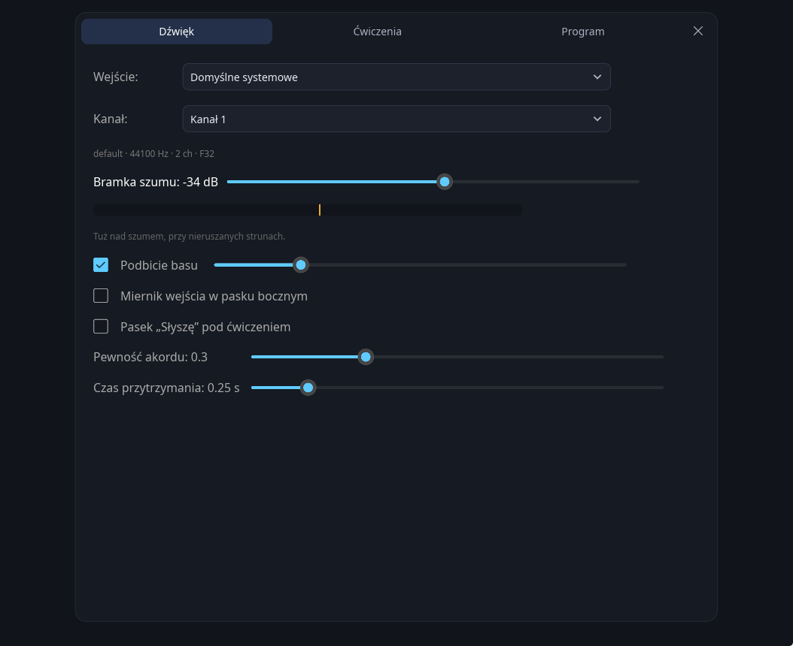
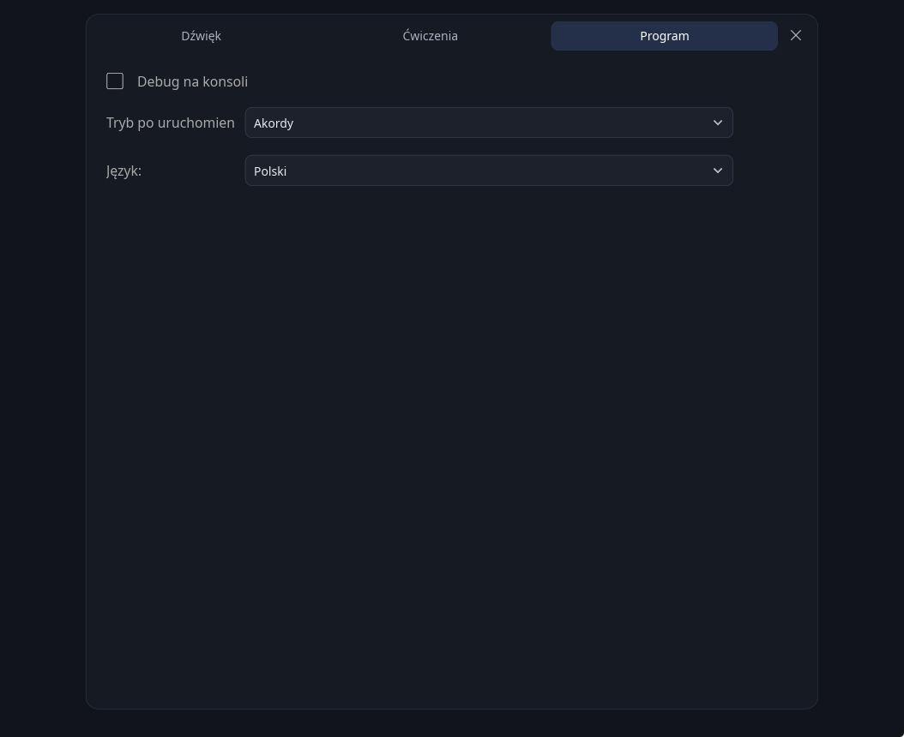
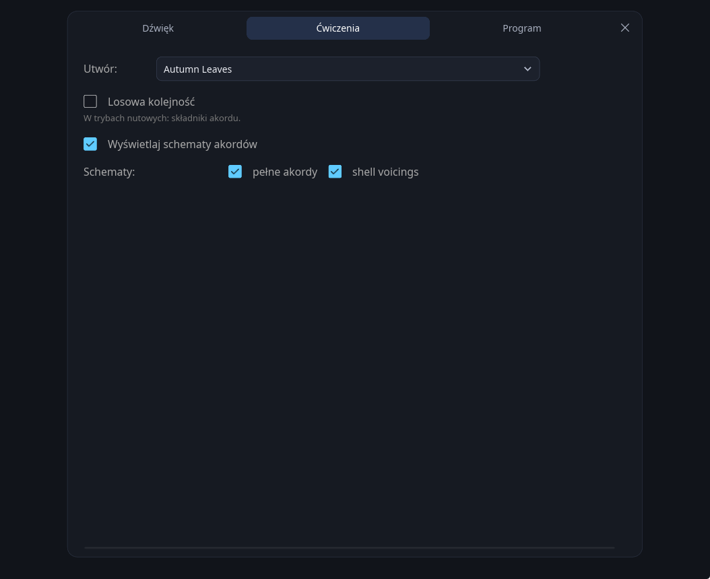
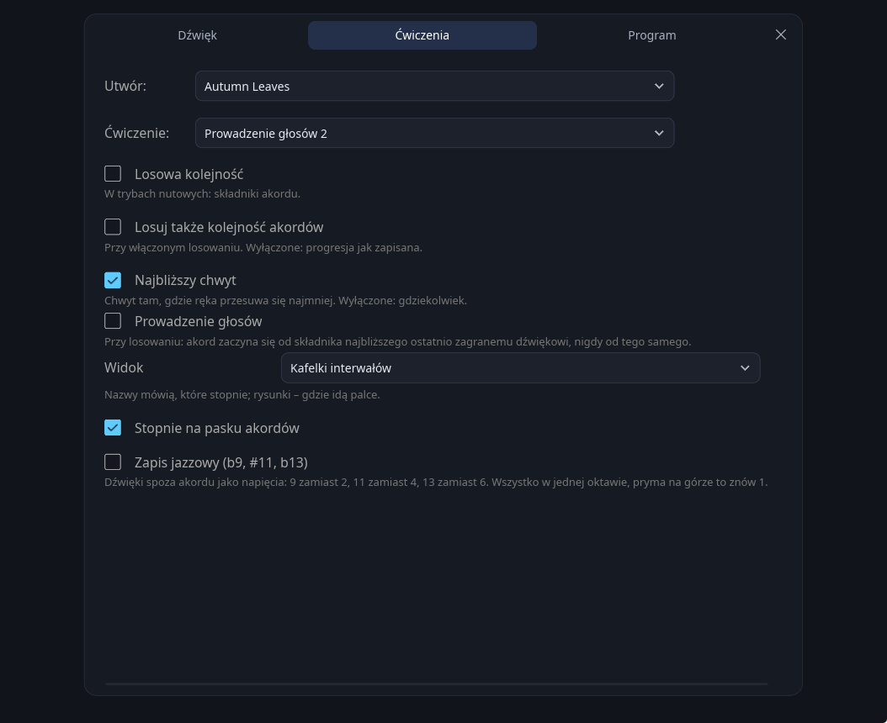
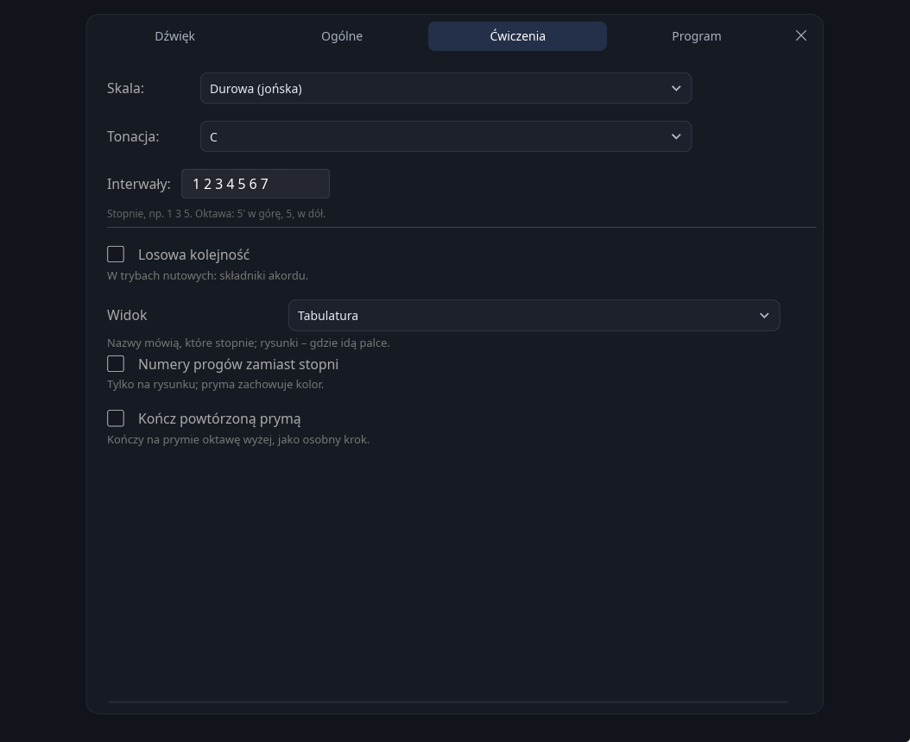
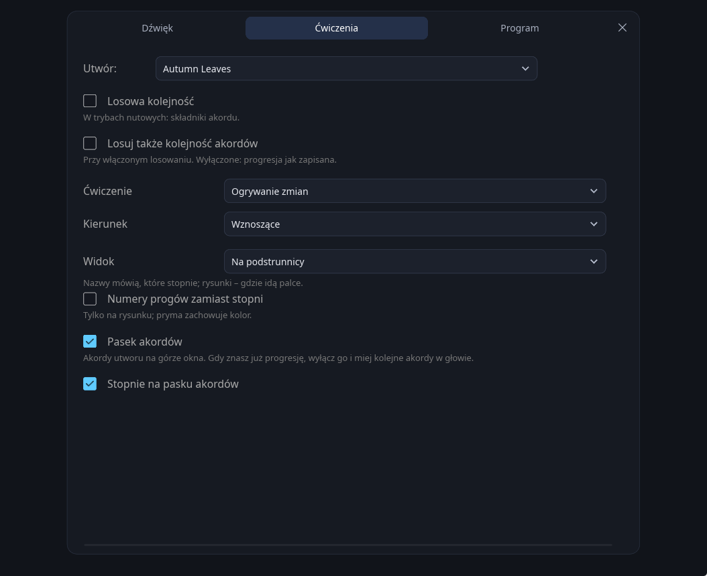
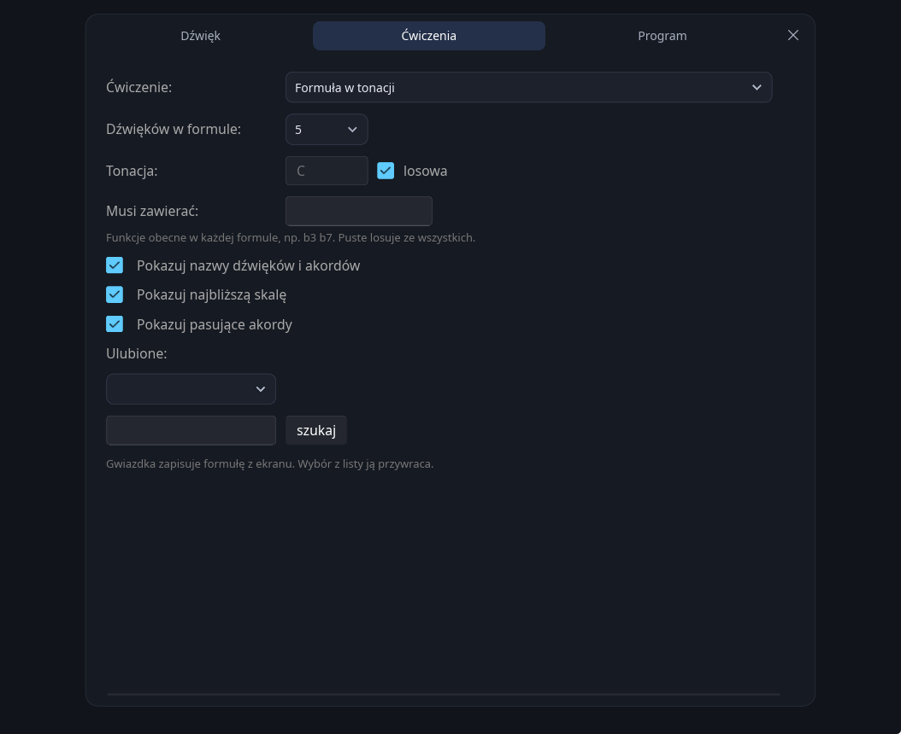

# Ustawienia

Wszystkie opcje z trzech zakładek oraz sterowanie w oknie głównym.

[← powrót do README](../README_pl.md)

---

Trzy zakładki: **Dźwięk** — wejście, bramka szumów i progi modelu, **Ćwiczenia** — co grać,
oraz **Program** — co pokazuje okno. To, jak surowo oceniane jest granie, ustawia się
w szybkich opcjach każdego trybu, w pasku bocznym — zob. [okno główne](#okno-główne).

**Ćwiczenia** zawierają wyłącznie to, co ma sens dla trybu widocznego na ekranie — utwór nie ma
nic do powiedzenia w Formułach, formuła nic w Akordach — więc w każdym trybie jest to inna
zakładka, a trener gryfu, który nie ma własnych ustawień, nie pokazuje jej wcale:

| Ustawienie | Opis |
|---|---|
| **Utwór / Skala** | Wybiera progresję albo skalę dla bieżącego trybu. Wybrany standard jest zapamiętywany — także między sesjami — i idzie za tobą przez wszystkie tryby, które go czytają: Akordy, Interwały, Arpeggia nad zmianami i Formuły nad standardem. Tak samo skala: Skale wracają do tej, na której skończyłeś, a nie na początek listy |
| **Studium** | Arpeggia, w ćwiczeniu ze studiami: którą frazę przechodzić. Przełącznik losowania znaczy tu **tonację**: nową po każdym przejściu. Arpeggio jest frazą, więc nie ma w nim czego tasować, a wybrane studium zostaje takie, jakie wskazałeś — generator jest osobną pozycją listy dla kogoś, kto chce też świeżej frazy. Najpierw trzy studia w jakościach akordu, potem łamane tercje i triole, dalej zwykłe przebiegi dwuoktawowe, a na końcu generator budujący świeżą frazę po każdym przejściu. Pole obok trzyma tonację |
| **Ćwiczenie** (arpeggia) | *Studium w tonacji* stoi na jednym akordzie — jego jakość ustawiasz niżej, tonację obok studium, a losowanie dobiera nową po każdym przejściu. *Ogrywanie zmian* bierze akordy z utworu i buduje po jednym arpeggiu na akord |
| **Kierunek** | Przy ogrywaniu zmian: wznoszące, opadające albo naprzemiennie z każdej ze stron. Opadające to kształt ze studiów — od prymy **w dół** przez składniki akordu, a nie fraza wznosząca czytana od tyłu |
| **Widok** | Trzy sposoby pokazania ćwiczenia: linia nazw stopni, tabulatura albo sama podstrunnica. Ustawienie jest osobne dla każdego trybu i zapisywane — skala to kolejność dźwięków i czyta się jako tabulatura, chwyt to kształt ręki i mówi coś dopiero na podstrunnicy. Domyślnie tabulatura w Skalach i Arpeggiach, podstrunnica w Interwałach. Gryf nie ma widoków: dźwięk, o który prosi, stoi na kafelku, a podpowiedź pod nim rysuje całą podstrunnicę. Fraza — skala albo arpeggio — rysowana jest na podstrunnicy, z białym pierścieniem wokół dźwięku, który jest teraz na kolei, i zielenią na każdym miejscu już zagranym. Fraza w górę i w dół wraca do własnych miejsc, więc na szczycie kształt jest zielony w całości, a o tym, gdzie się jest w drodze powrotnej, mówi pierścień — pierścień jest też na tabulaturze, bo przy skali rozdanej w losowej kolejności to jedyne, co mówi, w którym miejscu się jest; obrazek ma rozmiar ręki niezależnie od długości frazy, więc studium na trzydzieści dźwięków pozostaje czytelne. Skala rysowana jest w losowanej pozycji — kształt jest wszędzie ten sam, a rzecz w tym, żeby go znać tam, gdzie ręka akurat stanie. W kółku stoi stopień w pisowni ćwiczenia, więc skala zapisująca podwyższoną sekundę jako `#2` czyta się na gryfie jako `♯2`. W Interwałach zbiór rysowany jest jako **chwyt**: schemat jak przy akordach, struny w poprzek i progi w dół, z pozycją obok — pasek ma na osi poziomej kolejność dźwięków, a to nie mówi nic o tym, gdzie idą palce. Przy włączonym **Najbliższy chwyt** — domyślnie — każdy chwyt brany jest tam, gdzie palce mają najmniej do przejścia od poprzedniego, więc progresja sama przechodzi przez gryf. Wyłączone: każdy akord brany jest tam, gdzie gryf go daje, i tak poznaje się jeden kształt po całym gryfie, a nie w jednym jego rogu; losowanie też wyłącza prowadzenie. Przy włączonym losowaniu nie ma czego prowadzić: akordy idą w wylosowanej kolejności, a każdy chwyt brany jest tam, gdzie gryf go daje. To, na której strunie leży kółko, jest oktawą, więc apostrofy przestają być potrzebne; zagrane zapala się na zielono w obu widokach. Interwały mają czwarty widok, **kafelki**: każdy stopień na karcie, z dźwiękiem, na który wypada w tym akordzie, i z tym, czy jest teraz, dalej, czy już zaliczony |
| **Numery progów zamiast stopni** | Tylko na tym rysunku. Pryma zachowuje swój kolor |
| **Tonacja** | Skale: tonika, także w szybkich opcjach. Przy włączonej **Losowej tonacji** losowana od razu i od nowa po każdym przejściu, a z nią struna, od której zaczyna się skala. W Akordach szybkie opcje trzymają tonację utworu: inna transponuje każdy akord standardu, *(oryginał)* przywraca zapis, a nowy utwór zaczyna we własnej |
| **Ćwiczenie** (interwały) | Które dźwięki każdego akordu i w jakiej kolejności — pięćdziesiąt ćwiczeń zapisanych stopniami i czytanych względem akordu: `3` i `7` to ta tercja i septyma, które akord ma, `2`, `4`, `6` i `9` pochodzą z jego skali (lidyjskiej nad wielką septymą, miksolidyjskiej nad dominantą, doryckiej nad małą septymą, lokryckiej z wielką noną nad półzmniejszonym, zmniejszonej ton-półton nad zmniejszonym, molowej melodycznej nad `m6` i `mMaj7`). Po kolei: pojedyncze składniki, pary, triady i czterodźwięki, także w losowym przewrocie (↻); czterodźwiękowe struktury od prymy i od kwinty w czterech kolejnościach; prowadzenie głosów dla II-V-I, gdzie komórka każdego akordu kończy się o krok od miejsca, w którym zaczyna się następna; zawieszenie rozwiązane na tercję; i skala akordu przez oktawę, od 1, 3, 5, 7 albo od losowanego dźwięku, z dźwiękiem przejściowym — `(7)` albo `(#5)` — który stawia każdy składnik akordu na mocnej części taktu, albo bez niego. Losowanie rozdaje w innej kolejności zestawy i pierwszą komórkę każdej struktury; reszta grana jest tak, jak zapisano. Stopnie zapisane są zwykłymi numerami, bez oktawy — `5 6 7 2`, `1 3 5 7 1`: sędzia słyszy, który to dźwięk, a nie jak wysoko, więc każdy można zagrać tam, gdzie ręka go ma |
| **Interwały** | Skale i Arpeggia: stopnie przebiegu jako tekst. `3` obejmuje tercję wielką i małą, `5` kwintę czystą i zmniejszoną, zależnie od jakości akordu. Powyżej oktawy numery złożone — `9`, `10`, `12` — albo apostrof, `5'`; poniżej prymy przecinek, `5,` |
| **Pokazuj predykcję AI w oknie głównym** | Wyświetla surową odpowiedź modelu na ekranie głównym |
| **Wejście** | Które urządzenie przechwytujące otworzyć. *Domyślne systemowe* podąża za ustawieniem systemu. Zapamiętywane, z odwrotem do domyślnego, gdy urządzenia zabraknie |
| **Kanał** | Na którym wejściu urządzenia słuchać — gitara w gnieździe 2 interfejsu to kanał 2. Pokazywany tylko wtedy, gdy urządzenie ma więcej niż jeden, i nie ma opcji miksowania: uśrednianie wejść wciąga to, co jest na drugim gnieździe, i kosztuje 6 dB |
| **Bramka szumów** | Próg w dBFS. Pasek poniżej pokazuje bieżący poziom wejścia w tej samej skali, z progiem zaznaczonym żółtą kreską — ustaw go tuż nad szumem przy nietkniętych strunach |
| **Miernik wejścia w pasku bocznym** | Ten sam poziom i żółta kreska na karcie w pasku bocznym, nad nimi urządzenie, kanał i to, czy gitara jest słyszana. Domyślnie wyłączone; kliknięcie karty otwiera zakładkę Dźwięk |
| **Pasek „Słyszę” pod ćwiczeniem** | Co rozpoznaje model i jakie dźwięki słyszy, pod ćwiczeniem. Domyślnie wyłączone — w trakcie gry odciąga wzrok od schematów |
| **Podbicie basu** | Cyfrowe wzmocnienie najniższych prążków CQT. Przydatne przy mikrofonach laptopowych, które zwykle ścinają niskie struny |
| **Trzymaj jakość** (szybka opcja, Akordy) | Utrzymuje rozpoznaną jakość, dopóki nie uderzysz strun ponownie. Bez tego trzymane `m7` zmienia się w `m`, gdy septyma wybrzmiewa |
| **Krótkie uderzenia** (szybka opcja, Akordy) | Dla akordów uderzanych i puszczanych, a nie trzymanych. Liczy się jeden czysty odczyt celu, a wybrzmiewanie po nim nie może go cofnąć. Zły akord nadal nie przechodzi |
| **Tylko uderzone** (szybka opcja, Interwały) | Tryby nutowe: model może zaliczyć dźwięk tylko wtedy, gdy detektor uderzeń zgłosił uderzenie właśnie tego dźwięku w ostatnich 0,35 s — łącznie z odczytem nazwy akordu, który wcześniej się przez to prześlizgiwał i zaliczał dowolny dźwięk, jeśli akurat był prymą tego, co model nazwał. Zmierzone na nagraniu pojedynczych dźwięków: dwie trzecie zaliczeń, które model przyznaje dźwiękowi innemu niż grany, nie niesie żadnego ataku — prawie zawsze jest to dźwięk poprzedni, wciąż brzmiący w jego oknie 0,77 s. Domyślnie włączone w Interwałach, z osobno zapamiętywanym wyborem; w pozostałych trybach domyślnie wyłączone. Estymaty z pojedynczej ramki ta opcja nie dotyczy; w Formułach ma ona własną regułę, patrz [Jak to działa](how-it-works_pl.md) |
| **Pojedynczo** (szybka opcja) | Do wyboru w Interwałach i w Formułach. W Skalach, Arpeggiach i Gryfie obowiązuje zawsze, niezależnie od ustawienia — nikt nie uderza skali jak akordu — a Akordy mają własną regułę. W Formułach włączone: funkcja liczy się tylko z jednoramkowej estymaty, po jednym dźwięku; wyłączone: uderzony zbiór zalicza każdy dźwięk, który brzmi — przy 17 akordach uderzonych całą ręką 64 z 68 dźwięków zamiast 17. Wyłączone: uderzony akord zalicza swoje interwały jeden po drugim — głowica wysokości jest polifoniczna i raportuje wszystkie dźwięki naraz. Włączone: liczy się wyłącznie estymata jednoklatkowa, i to dopiero gdy utrzyma się przez trzy klatki audio: zmierzone na 49 dźwiękach — cztery drogi zaliczenia razem dały 110 zaliczeń rzeczy niegranych, sama ustabilizowana estymata 33, i nie przegapiła żadnego dźwięku. **Domyślnie włączone w Interwałach**, razem ze stałą kolejnością i „zaliczaj tylko to, co uderzone" — te trzy razem są drogą zmierzoną. Odznaczone wszystkie trzy i tryb staje się tym drugim, czym może być: decyduje model i nic z nim nie dyskutuje, łącznie z przenoszeniem zaliczeń między akordami — czyli Interwały bez „pojedynczo, po kolei, tylko uderzone” |
| **Losowa kolejność** | Ikona losowania na pasku narzędzi. W trybach nutowych miesza dźwięki wewnątrz każdego akordu; w Akordach zmienia kolejność progresji, a w Skalach losuje tonację po każdym przejściu |
| **Losuj także kolejność akordów** | Tylko Interwały i Arpeggia, i tylko przy włączonym losowaniu. Wyłączone: progresja zostaje taka, jak zapisana, a ruszają się same dźwięki — pomieszane interwały idące po prawdziwej progresji zamieniają się w melodie. Włączone: akordy również są losowane, co jest ćwiczeniem bardziej abstrakcyjnym |
| **Ćwiczenie** (formuły) | *Formuła w tonacji* to tryb w postaci pierwotnej. *Nad akordem* stawia tę samą formułę na jednym wylosowanym akordzie, a *Nad standardem* na każdym akordzie utworu po kolei — formuła jest stała, harmonia pod nią się zmienia |
| **Nałożenie** | Nad akordem: jakiego rodzaju nałożenie losować — takie, które opisuje akord, barwi go, stoi na zewnątrz, albo dowolne. Ekran pokazuje funkcje formuły czytane od prymy akordu, z jego własnymi dźwiękami na niebiesko, i je zlicza |
| **Dźwięków w formule** | Tylko Formuły: ile funkcji ma każda losowana formuła, wliczając prymę |
| **Tonacja** (formuły) | Pryma, względem której je czytać, albo świeżo losowana do każdej formuły |
| **Musi zawierać** | Losuj wyłącznie formuły zawierające te funkcje, np. `b3 b7`. Puste pole losuje ze wszystkich 2048 |
| **Pokazuj nazwy dźwięków i akordów** | Tylko Formuły: litery pod funkcjami i pod akordami |
| **Pokazuj najbliższą skalę** | Tylko Formuły: najbliższa skala, którą już znasz, rozpisana z wyróżnionymi stopniami formuły |
| **Pokazuj pasujące akordy** | Tylko Formuły: akordy grywalne bez wychodzenia ze zbioru, zapisane stopniami. Tylko najpełniejsze — nad gamą durową zostaje dokładnie siedem akordów septymowych diatonicznych |
| **Ulubione** | Tylko Formuły: gwiazdka zapisuje formułę z ekranu pod nazwą, a wybór z listy ją przywraca. Krzyżyk na wierszu ją usuwa |
| **Po kolei** (szybka opcja, Formuły) | Formuły: zbiór trzeba przejść od najniższej funkcji. Wyłączone — jest zbiorem, dowolny dźwięk w dowolnej kolejności |
| **Po kolei** (szybka opcja, Interwały) | Domyślnie włączone: interwały zalicza się w kolejności rozdania, także po jej wylosowaniu. Własny zapisany wybór pozostaje zachowany. W Skalach i Arpeggiach kolejność obowiązuje zawsze |
| **Debug na konsoli** | Wypisuje linię dla każdej zaliczonej funkcji wraz z tym, co usłyszano. Okno na ocenianie; w Windowsie wydanie release nie ma konsoli, na której mogłoby to wypisać |
| **Kończ powtórzoną prymą** | Tylko Skale: przebieg czyta się 1 2 3 4 5 6 7 8, gdzie 8 to pryma oktawę wyżej. To osobny krok i trzeba go zagrać |
| **Tam i z powrotem** | Skale: w górę i z powrotem w jednym przebiegu, także w szybkich opcjach |
| **Początek** | Skale: przebieg zaczyna się od 1, 3, 5 albo 7 skali, albo od dźwięku losowanego na każdy przebieg, i idzie przez oktawę do tego samego dźwięku. Przy **Od E do e** przebieg zaczyna się od tego stopnia pod ręką losowaną na każdy przebieg, na skrajnej strunie, która go ma |
| **Ruch tonacji** | Skale, przy wyłączonym losowaniu: po każdym przebiegu tonacja zostaje, przesuwa się o półton w górę lub w dół albo idzie kołem kwintowym lub kwartowym |
| **Zapis jazzowy** | Skale, skale akordowe w Interwałach i Formuły: to, co leży między składnikami akordu, nazywane jest napięciem nad nim — `b9` zamiast `b2`, `11` zamiast `4`, `13` zamiast `6` — więc frygijska dominantowa to `1 b9 3 4 5 b13 b7`. Zwykła `4` nad tercją wielką zostaje `4`: leży półton nad tercją, więc się przez nią przechodzi, a nie zatrzymuje. Nic nie jest liczone ponad oktawę: pryma na górze to znów `1`, a wysokość widać na gryfie. Domyślnie wyłączony; listy ćwiczeń zawsze mają zwykłe stopnie |
| **Prowadzenie głosów** | Interwały, przy włączonym losowaniu: każdy akord zaczyna się od składnika najbliższego ostatnio zagranemu dźwiękowi, nigdy od tego samego, więc wylosowane ćwiczenie dalej czyta się jak linia |
| **Pokazuj schematy akordów** | Miniatury diagramów pod nazwą akordu w trybie Akordy |
| **Schematy** | Dwa pola: pełne akordy i shell voicings — tercja i septyma nad prymą. Zaznaczone oba rysują oba, żadne nie rysuje nic. Powyżej czterech schematów rysowane są w dwóch rzędach. `m7b5` nie ma własnego shella: jego shell to co do dźwięku shell `m7`, bo różni je wyłącznie kwinta, więc to właśnie jest rysowane, z podpisem *substytut: shell m7*. Gdy na ekranie są same shelle, ten chwyt jest tym, o który program prosi, więc jego zagranie przechodzi na zielono; gdy rysowane są też pełne schematy, odczyt `m7` oznacza pominiętą obniżoną kwintę i zostaje żółty. Akord zmniejszony septymowy nie ma czego pominąć — cztery dźwięki co małą tercję, bez pary tercja-septyma, którą można by zachować — więc zostaje przy pełnych chwytach, z podpisem mówiącym, czym one też są: `7b9` bez prymy, o pół tonu poniżej każdego swojego dźwięku |
| **Tryb startowy** | W jakim trybie program się otwiera |
| **Język** | Auto (z ustawień systemu), polski, angielski. Stosowany natychmiast, bez restartu |
| **Pewność akordu** | Jak pewny musi być model *nazwy* akordu, żeby została zaliczona (tryb Akordy) |
| **Próg dźwięku** | Jak pewny musi być model, że *pojedynczy dźwięk* brzmi (Interwały / Skale / Arpeggia) |
| **Czas trzymania** | Jak długo poprawny akord musi być trzymany, zanim program przejdzie dalej. Dotyczy akordów: pojedynczy dźwięk zalicza się, gdy tylko zostanie rozpoznany, co w trybach nutowych i w Gryfie oznacza stałe 0,12 s |

Linia pod napisem `Channel` mówi, co faktycznie zostało otwarte — urządzenie, częstotliwość
próbkowania, liczbę kanałów i format próbek. `./solitito --help` wypisuje wszystkie opcje.
`./solitito --devices` podaje te same informacje dla każdego urządzenia widocznego dla
backendu, a `./solitito --bench` mierzy czas jednego przejścia modelu — program pyta model co
40 ms, dopóki akord brzmi, więc ta liczba jest w praktyce całym jego obciążeniem procesora.
Wydanie release ma podsystem `windows`, więc w Windowsie tryby te piszą do konsoli, z której
zostały uruchomione; uruchomione zupełnie bez konsoli — ze skrótu niosącego flagę — otwierają
własną i czekają na klawisz, żeby raport dało się przeczytać.

---

## Okno główne

Trzy elementy sterowania leżą poza panelem ustawień, w samym oknie.

**Rząd akordów u góry** pokazuje, gdzie w utworze jesteś: siedem akordów, bieżący idzie do
środka i tam zostaje, z trzema następnymi — za ostatnim akordem wchodzą akordy kolejnego
okrążenia. Akord zostawiony za sobą zachowuje kolor, na jaki zasłużył — zielony przy trafieniu
dokładnym, żółty gdy przeszedł triadą albo zamianą — a przeskoczony zostaje szary. Kliknięcie
w akord zatrzymuje ćwiczenie i przechodzi do niego. **Tytuł utworu** pod nim otwiera listę
utworów.

**Szybkie opcje** rozwijają się w pasku bocznym pod bieżącym trybem: kliknięcie w jego pozycję
rozwija je albo zwija, a strzałka obok mówi, w którą stronę. To przełączniki, po które warto
sięgać w trakcie grania:

| tryb | szybkie opcje |
|---|---|
| Akordy | tonacja utworu, **Pełne chwyty**, **Shelle**, **Trzymaj jakość**, **Krótkie uderzenia** |
| Interwały | ćwiczenie, **Pojedynczo**, **Po kolei**, **Tylko uderzone** |
| Skale | tonacja, **W górę**, **W dół**, **Losowo**, **Po kolei**, **Od E do e**, **Tam i z powrotem** |
| Arpeggia | ćwiczenie oraz akord studium albo kierunek przy ogrywaniu zmian |
| Formuły | ćwiczenie, liczba dźwięków w formule, **Pojedynczo**, **Po kolei** |
| Gryf | **Podpowiedź**: gryf do 15. progu z każdym miejscem szukanego dźwięku, przy każdym dźwięku; wyłączona, pokazuje ją jednorazowo kliknięcie w dźwięk |

W Skalach **Losowo** losuje kierunek na każdy przebieg, nigdy trzy razy w tę samą stronę;
przy wyłączonym **Po kolei** dźwięki można grać w dowolnej kolejności. **Od E do e** to skala
pod jedną ręką, od niskiej struny E do wysokiej e. Ręka stoi na progu, na którym stopień
wybrany w **Początku** leży na którejś strunie, w pierwszych dwunastu — przy każdym przebiegu
na innym — i obejmuje próg niżej i trzy wyżej, a od pustej struny progi 0–4; nie przesuwa się.
W górę przebieg zaczyna się od tego stopnia najniżej, jak ręka go ma — na niskiej E, jeśli tam
leży — i idzie do góry; w dół zaczyna najwyżej — na wysokiej e — i schodzi na dół. **Tam
i z powrotem** wraca do startu. Domyślnie włączone.

**Losowanie** znaczy w każdym trybie co innego, bo w każdym co innego warto losować:

| tryb | co losuje |
|---|---|
| Akordy | kolejność standardu |
| Interwały | składniki wewnątrz akordu; kolejność akordów zostaje zapisana, chyba że włączysz **Losuj także kolejność akordów** |
| Skale | tonację — od razu i po każdym przejściu — oraz strunę, od której zaczyna się skala |
| Arpeggia | tonację w studiach, kolejność akordów przy ogrywaniu zmian |

Losowanie nigdy nie zmienia kolejności dźwięków w Skalach i Arpeggiach: rozdana losowo skala
albo studium nie jest już tą skalą ani tym studium.

Przy wyłączonym losowaniu skala i tak przesuwa się po każdym przejściu: tonacja tak, jak mówi
**Ruch tonacji**, a jeśli skala nie idzie od E do e, także struna, od której się zaczyna —
losowana spośród trzech, od których warto zaczynać, nigdy ta sama co w poprzednim przebiegu.

**Pauza** zatrzymuje progresję, a kolory dalej mówią, czy akord jest właściwy — można zostać
przy jednym chwycie i go opracować. Przy pauzie strzałki po bokach przycisku pauzy przechodzą tam
i z powrotem po progresji.

Puste struny w gripach interwałów są rysowane jako niewypełnione kółka poza kolumnami progów, z interwałem w środku. Nie trafiają na pierwszy próg.
